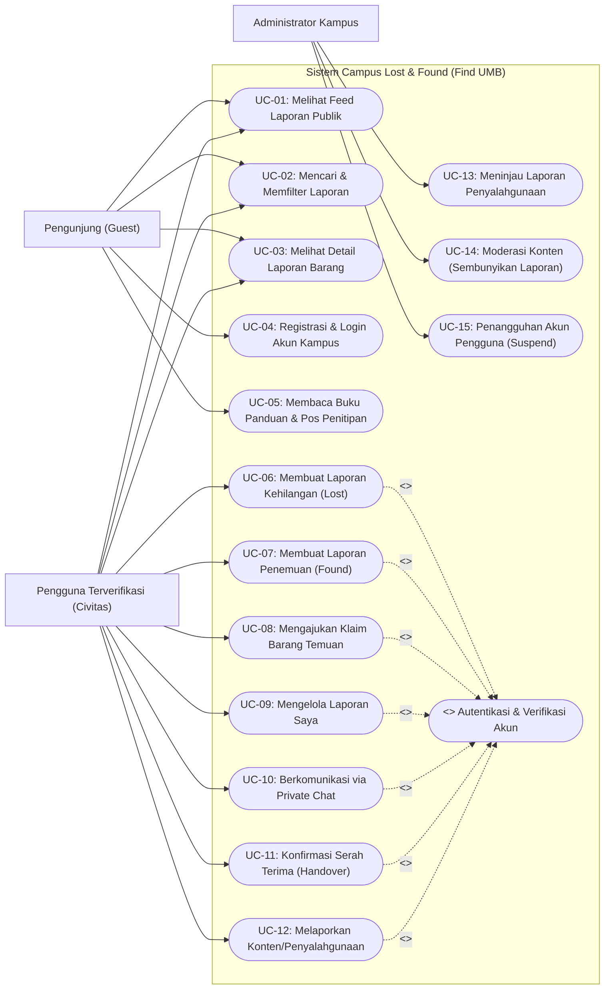
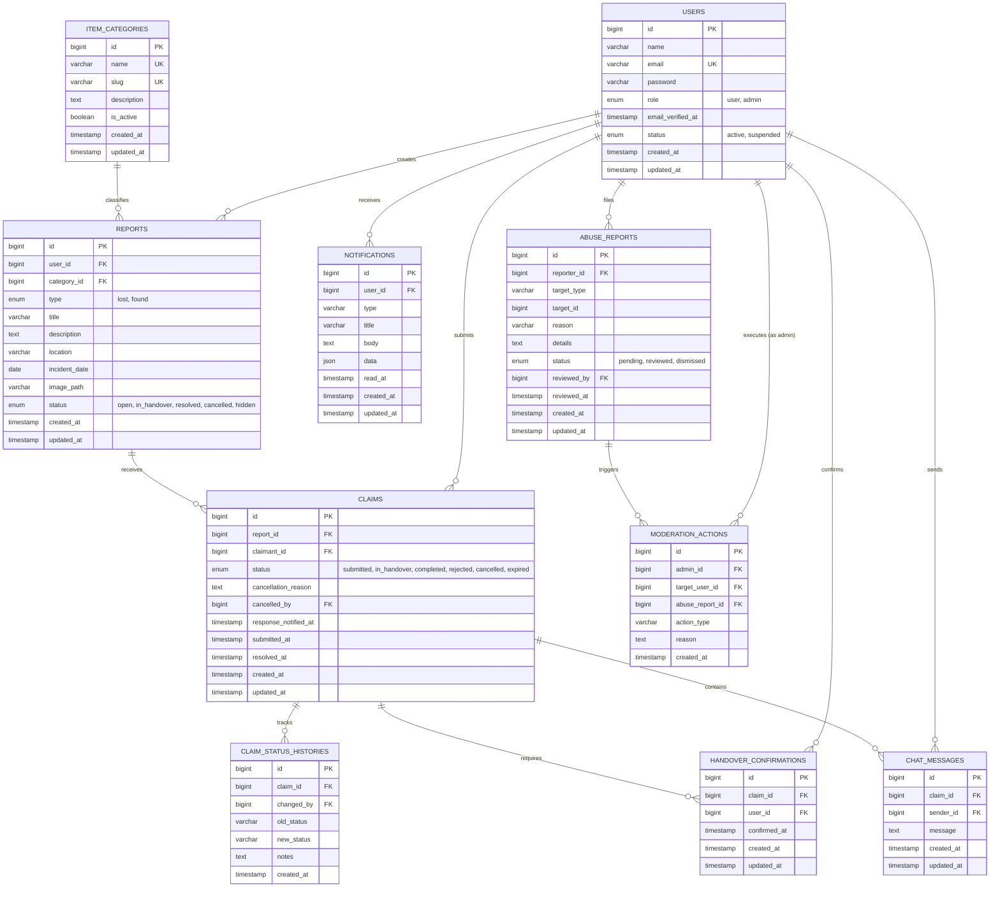

# LEMBAR JAWABAN UJIAN TENGAH SEMESTER (UTS)
## MATAKULIAH: PEMROGRAMAN WEB ENTERPRISE

---

* **Nama Aplikasi:** Find UMB (*Campus Lost & Found Platform*)
* **Institusi / Kampus Basis:** Universitas Mercu Buana
* **Teknologi Utama:** PHP 8.2+, Laravel 11.x, Blade Template Engine, MySQL 8.x, Mobile-First PWA Responsive UI

---

## DAFTAR ISI

1. [P1. Tema Aplikasi Web, Tujuan, dan Fungsi Utama (Bobot: 2)](#p1-tema-aplikasi-web-tujuan-dan-fungsi-utama-bobot-2)
2. [P2. Diagram Use Case dan Interaksi Pengguna-Sistem (Bobot: 2)](#p2-diagram-use-case-dan-interaksi-pengguna-sistem-bobot-2)
3. [P3. Perancangan Diagram Basis Data / ERD (Bobot: 6)](#p3-perancangan-diagram-basis-data--erd-bobot-6)
4. [P4. Implementasi 6 Halaman Tampilan Blade Template Laravel (Bobot: 10)](#p4-implementasi-6-halaman-tampilan-blade-template-laravel-bobot-10)
5. [P5. Implementasi Skema Migrasi Basis Data dan Model Eloquent Laravel (Bobot: 10)](#p5-implementasi-skema-migrasi-basis-data-dan-model-eloquent-laravel-bobot-10)

---

## P1. Tema Aplikasi Web, Tujuan, dan Fungsi Utama (Bobot: 2)
**Sub-CPMK 3.2.1:** Mampu menentukan tema, tujuan, dan merancang fungsi utama sistem aplikasi enterprise.

---

### 1.1 Tema Aplikasi Web
Tema aplikasi yang dikembangkan adalah **Sistem Informasi Pelayanan Sivitas Akademika Berbasis Web Terintegrasi (*Campus Enterprise Lost & Found Information System*)**, dengan nama sistem **Find UMB (Campus Lost & Found)**.

Aplikasi ini dirancang menggunakan pendekatan arsitektur *Mobile-First Web App* yang responsif, mengadopsi standar Progressive Web App (PWA) untuk memberikan kenyamanan akses seluler bagi seluruh sivitas akademika (mahasiswa, dosen, tenaga kependidikan, staf keamanan/satpam, dan pengelola fasilitas kampus).

---

### 1.2 Latar Belakang dan Tujuan Aplikasi

#### A. Latar Belakang Masalah
Di lingkungan perguruan tinggi dengan mobilitas civitas yang tinggi dan area gedung perkuliahan yang luas, insiden kehilangan dan penemuan barang berharga (seperti KTM, dompet, laptop, smartphone, kunci kendaraan, dan dokumen akademik) terjadi setiap hari. Namun, penanganan yang berjalan selama ini menghadapi kendala krusial:
* **Fragmentasi Informasi:** Pengumuman barang hilang atau ditemukan tersebar secara acak di berbagai grup pesan instan (WhatsApp, Telegram) atau media sosial tanpa pengarsipan terstruktur.
* **Risiko Pelanggaran Privasi dan Penipuan:** Pengumuman di media sosial sering kali mencantumkan nomor telepon pribadi penemu/pemilik secara terbuka, membuka celah terjadinya spam, penipuan bermodus tebusan, atau pelecehan.
* **Ketiadaan Validasi Kepemilikan:** Tidak adanya mekanisme pembuktian yang baku menyebabkan rawan terjadi salah serah terima atau klaim sepihak oleh pihak yang tidak berhak.
* **Ketidakjelasan Status Penyelesaian:** Tidak ada sistem yang mencatat apakah barang yang dilaporkan sudah kembali ke pemilik aslinya atau masih berada di pos pengamanan/penitipan.

#### B. Tujuan Aplikasi
Berdasarkan permasalahan di atas, tujuan dibangunnya aplikasi **Find UMB** adalah:
1. **Sentralisasi Informasi Kampus:** Memusatkan seluruh data laporan barang hilang (*lost*) dan barang temuan (*found*) di lingkungan Universitas Mercu Buana ke dalam satu portal digital resmi yang terorganisasi dan mudah ditelusuri.
2. **Perlindungan Privasi Civitas:** Menjaga kerahasiaan identitas kontak pribadi sivitas akademika dengan mengisolasi jalur komunikasi langsung melalui fitur *In-App Private Messaging* resmi tanpa mengekspos nomor ponsel atau akun media sosial pengguna.
3. **Standarisasi Alur Verifikasi Klaim:** Menyediakan protokol validasi kepemilikan terstruktur, di mana pemilik sah wajib membuktikan ciri khusus rahasia (*unique confidential identifiers*) dari barang sebelum penemu menyetujui penyerahan.
4. **Jaminan Integritas Serah Terima Barang:** Menjamin akuntabilitas pengembalian barang melalui mekanisme konfirmasi ganda (*Two-Party Mutual Handover Confirmation*) yang mengunci transaksi dan mengubah status laporan menjadi selesai secara permanen (*immutable resolved state*).
5. **Dukungan Pos Penitipan Resmi Kampus:** Mengintegrasikan sistem pelaporan dengan pos penitipan fisik resmi kampus (seperti Pos Satpam Gerbang Utama, Pos Menara/Tower, dan Layanan Perpustakaan Kampus).

---

### 1.3 Fungsi Utama Aplikasi

Aplikasi **Find UMB** memiliki tujuh (7) fungsi utama tingkat *enterprise*:

1. **Manajemen Pelaporan Cerdas (*Smart Item Reporting System*)**
   * Menyediakan formulir pelaporan terpisah yang teroptimasi untuk **Lapor Kehilangan (*Report Lost*)** dan **Lapor Penemuan (*Report Found*)**.
   * Dilengkapi fitur unggah dokumentasi foto barang, pemilihan kategori barang terindeks, penentuan lokasi spesifik gedung/ruangan kampus, pencatatan waktu kejadian, hingga pemilahan opsi penyimpanan (*Disimpan Sendiri oleh Penemu* vs *Dititipkan di Pos Satpam/Perpustakaan*).
   * Fitur pemisahan deskripsi publik dan ciri rahasia kepemilikan untuk proteksi validasi.

2. **Pencarian Cerdas dan Multi-Filter (*Advanced Search & Multi-Criteria Filtering*)**
   * Memungkinkan pencarian instan berbasis kata kunci (*keyword instant query*).
   * Filter dinamis multi-kriteria berdasarkan jenis laporan (*Semua*, *Kehilangan*, *Temuan*), kategori barang (Elektronik, Dompet, Dokumen/KTM, Kunci, Pakaian/Tas), status laporan (*Open*, *In Handover*, *Resolved*), serta zonasi lokasi gedung kampus.

3. **Sistem Pengajuan dan Validasi Klaim (*Structured Claim Handling Engine*)**
   * Pengguna yang merasa kehilangan barang dapat mengajukan klaim resmi terhadap postingan barang temuan.
   * Menerapkan aturan bisnis (*business rules*) ketat: satu pengguna hanya boleh memiliki satu klaim aktif pada satu waktu guna mencegah praktik spamming klaim di banyak barang sekaligus.

4. **Komunikasi Terproteksi Antara Civitas (*Encrypted In-App Private Chat*)**
   * Ruang percakapan privat antara penemu dan pengklaim yang terikat langsung pada ID klaim barang.
   * Memfasilitasi proses tanya-jawab pencocokan ciri fisik rahasia dan kesepakatan lokasi/waktu pertemuan secara aman di dalam platform.

5. **Mekanisme Konfirmasi Serah Terima Dua Pihak (*Two-Party Mutual Handover Confirmation*)**
   * Proses fisik pengembalian barang wajib diverifikasi oleh kedua belah pihak di dalam sistem.
   * Transaksi dinyatakan tuntas (*Resolved*) hanya jika penemu dan pengklaim sama-sama menekan tombol konfirmasi serah terima, sehingga menghilangkan potensi sengketa di kemudian hari.

6. **Dasbor Pemantauan Status & Laporan Saya (*My Reports Tracking Dashboard*)**
   * Dasbor personal bagi pengguna untuk memantau status siklus hidup laporan (*Open*, *In Handover*, *Resolved*, *Cancelled*), melihat daftar klaim yang masuk dari pengguna lain, dan membatalkan laporan jika barang telah ditemukan secara mandiri.

7. **Sistem Moderasi dan Keamanan Komunitas (*Abuse Reporting & Moderation Subsystem*)**
   * Fitur bagi pengguna untuk melaporkan postingan atau pesan mencurigakan (*spam*, penipuan, konten tidak pantas).
   * Dasbor bagi administrator kampus untuk meninjau laporan penyalahgunaan, menyembunyikan laporan bermasalah (*hidden*), serta menangguhkan akun pelanggar (*suspend*).

---

## P2. Diagram Use Case dan Interaksi Pengguna-Sistem (Bobot: 2)
**Sub-CPMK 3.2.1:** Mampu merancang diagram use case sederhana yang menggambarkan interaksi antara pengguna dan sistem enterprise.

---

### 2.1 Identifikasi Aktor Sistem

Sistem **Find UMB** melibatkan tiga (3) aktor utama:
1. **Pengunjung (*Guest / Unauthenticated User*):** Civitas kampus yang belum melakukan login ke dalam sistem. Memiliki akses hanya-baca (*read-only*) terhadap informasi publik.
2. **Pengguna Terverifikasi (*Verified Campus User*):** Mahasiswa, dosen, atau staf Universitas Mercu Buana yang telah memiliki akun terdaftar dan tervalidasi menggunakan email resmi kampus (@mercubuana.ac.id). Memiliki akses penuh terhadap transaksi pelaporan, klaim, dan percakapan.
3. **Administrator (*Campus Admin*):** Petugas berwenang (Biro Kemahasiswaan / Pengelola Fasilitas / Satpam Kampus) yang bertugas menjaga ketertiban platform dan menangani laporan pelanggaran pengguna.

---

### 2.2 Diagram Use Case (Mermaid Format)



---

### 2.3 Deskripsi Rinci Interaksi Use Case Utama

| ID Use Case | Aktor Terlibat | Deskripsi Interaksi Antara Pengguna dan Sistem |
|---|---|---|
| **UC-01** | Pengunjung, Civitas | Pengguna membuka aplikasi untuk melihat daftar feed kartu laporan barang hilang dan temuan terbaru yang berstatus *Open* di halaman beranda. |
| **UC-02** | Pengunjung, Civitas | Pengguna memasukkan kata kunci pencarian pada search bar dan memilih pill filter kategori, jenis laporan, atau lokasi kampus; sistem menampilkan hasil pencarian secara dinamis. |
| **UC-03** | Pengunjung, Civitas | Pengguna memilih salah satu kartu laporan untuk melihat foto, kronologi kejadian, kategori, dan perkiraan lokasi. Sistem menyembunyikan kontak pribadi pembuat laporan untuk menjaga privasi. |
| **UC-04** | Pengunjung | Pengguna mendaftarkan akun baru menggunakan email resmi universitas, sistem mengirimkan tautan verifikasi, dan pengguna melakukan proses login berbasis sesi Laravel. |
| **UC-06 & UC-07** | Civitas Terverifikasi | Pengguna menekan tombol aksi (+) pada navigasi, mengisi formulir lengkap (judul, deskripsi, foto bukti, kategori, tanggal, lokasi penemuan/pos satpam), dan sistem menyimpan laporan dengan status awal `open`. |
| **UC-08** | Civitas Terverifikasi | Pengguna yang mengenali barang miliknya pada laporan berjenis `found` menekan tombol "Ajukan Klaim". Sistem memvalidasi bahwa pengguna tidak memiliki klaim aktif lain, kemudian membuat record klaim berstatus `submitted`. |
| **UC-10** | Civitas Terverifikasi | Penemu dan pengklaim membuka ruang pesan privat (*Chat*) untuk saling bertukar pesan klarifikasi ciri fisik rahasia dan menentukan jadwal pertemuan serah terima. |
| **UC-11** | Civitas Terverifikasi | Setelah bertemu langsung, kedua pihak menekan tombol "Konfirmasi Serah Terima". Begitu tercatat 2 konfirmasi sah dari penemu dan pengklaim, sistem secara atomik mengubah status klaim menjadi `completed` dan laporan menjadi `resolved`. |
| **UC-13 - UC-15** | Administrator | Petugas administrator memeriksa daftar aduan penyalahgunaan (*abuse reports*), memeriksa rekaman log, menyembunyikan laporan palsu (`hidden`), dan menangguhkan akun pengguna yang terbukti melanggar aturan (`suspended`). |

---

## P3. Perancangan Diagram Basis Data / ERD (Bobot: 6)
**Sub-CPMK 3.2.1:** Mampu merancang diagram basis data (*database diagram*) yang mencakup nama tabel, atribut, tipe data, dan relasi antar tabel sesuai kebutuhan aplikasi enterprise.

---

### 3.1 Diagram Relasi Entitas (Entity-Relationship Diagram / ERD)



---

### 3.2 Kamus Data Struktur Tabel (*Data Dictionary*)

#### 1. Tabel `users`
Menyimpan kredensial identitas civitas akademika dan administrator kampus.
* `id` (`BIGINT UNSIGNED`, PK, Auto Increment) — Identifier unik pengguna.
* `name` (`VARCHAR(255)`, Not Null) — Nama lengkap pengguna.
* `email` (`VARCHAR(255)`, Not Null, Unique) — Alamat email resmi kampus.
* `password` (`VARCHAR(255)`, Not Null) — Hash kata sandi pengguna (Bcrypt/Argon2id).
* `role` (`ENUM('user','admin')`, Default `'user'`, Not Null) — Peran akun pengguna.
* `email_verified_at` (`TIMESTAMP`, Nullable) — Waktu penyelesaian verifikasi email.
* `status` (`ENUM('active','suspended')`, Default `'active'`, Not Null) — Status operasional akun.
* `created_at` & `updated_at` (`TIMESTAMP`, Nullable) — Jejak audit waktu pembuatan dan pengubahan.

#### 2. Tabel `item_categories`
Menyimpan master data kategori klasifikasi barang (Elektronik, Dokumen/KTM, Dompet, Tas, Kunci, dll.).
* `id` (`BIGINT UNSIGNED`, PK, Auto Increment) — Identifier unik kategori.
* `name` (`VARCHAR(100)`, Not Null, Unique) — Nama kategori barang.
* `slug` (`VARCHAR(120)`, Not Null, Unique) — Identifier ramah URL.
* `description` (`TEXT`, Nullable) — Penjelasan detail kategori barang.
* `is_active` (`BOOLEAN`, Default `true`, Not Null) — Status ketersediaan kategori pada formulir.
* `created_at` & `updated_at` (`TIMESTAMP`, Nullable) — Waktu audit sistem.

#### 3. Tabel `reports`
Menyimpan data publikasi laporan barang hilang maupun barang temuan di lingkungan kampus.
* `id` (`BIGINT UNSIGNED`, PK, Auto Increment) — Identifier unik laporan.
* `user_id` (`BIGINT UNSIGNED`, Not Null, FK ke `users.id`) — Pengguna pembuat laporan.
* `category_id` (`BIGINT UNSIGNED`, Not Null, FK ke `item_categories.id`) — Kategori barang.
* `type` (`ENUM('lost','found')`, Not Null) — Tipe laporan (hilang atau temuan).
* `title` (`VARCHAR(255)`, Not Null) — Judul ringkas laporan barang.
* `description` (`TEXT`, Not Null) — Rincian ciri fisik, kronologi, dan catatan penemuan.
* `location` (`VARCHAR(255)`, Not Null) — Lokasi spesifik kejadian di area kampus.
* `incident_date` (`DATE`, Not Null) — Tanggal kejadian kehilangan/penemuan.
* `image_path` (`VARCHAR(255)`, Nullable) — Lokasi berkas foto dokumentasi barang pada storage server.
* `status` (`ENUM('open','in_handover','resolved','cancelled','hidden')`, Default `'open'`, Not Null) — Status laporan.
* `created_at` & `updated_at` (`TIMESTAMP`, Nullable) — Waktu audit record.

#### 4. Tabel `claims`
Menyimpan transaksi pengajuan klaim kepemilikan oleh civitas terhadap laporan barang temuan (`type = 'found'`).
* `id` (`BIGINT UNSIGNED`, PK, Auto Increment) — Identifier unik klaim.
* `report_id` (`BIGINT UNSIGNED`, Not Null, FK ke `reports.id`) — Laporan barang temuan yang diklaim.
* `claimant_id` (`BIGINT UNSIGNED`, Not Null, FK ke `users.id`) — Pengguna yang mengajukan klaim.
* `status` (`ENUM('submitted','in_handover','completed','rejected','cancelled','expired')`, Default `'submitted'`, Not Null) — Status tahapan klaim.
* `cancellation_reason` (`TEXT`, Nullable) — Alasan pembatalan proses klaim/serah terima.
* `cancelled_by` (`BIGINT UNSIGNED`, Nullable, FK ke `users.id`) — Aktor yang membatalkan (penemu, pengklaim, admin, atau NULL jika sistem).
* `response_notified_at` (`TIMESTAMP`, Nullable) — Waktu pengiriman notifikasi pengingat tanggapan.
* `submitted_at` (`TIMESTAMP`, Not Null) — Waktu resmi pengajuan klaim.
* `resolved_at` (`TIMESTAMP`, Nullable) — Waktu tuntasnya proses serah terima atau pembatalan permanen.
* `created_at` & `updated_at` (`TIMESTAMP`, Nullable) — Waktu audit sistem.

#### 5. Tabel `claim_status_histories`
Mencatat seluruh rekam jejak audit (*audit trail*) transisi siklus hidup status setiap klaim.
* `id` (`BIGINT UNSIGNED`, PK, Auto Increment) — Identifier unik riwayat status.
* `claim_id` (`BIGINT UNSIGNED`, Not Null, FK ke `claims.id`) — Klaim terkait.
* `changed_by` (`BIGINT UNSIGNED`, Nullable, FK ke `users.id`) — Aktor pemicu transisi status.
* `old_status` (`VARCHAR(50)`, Not Null) — Status sebelumnya.
* `new_status` (`VARCHAR(50)`, Not Null) — Status baru.
* `notes` (`TEXT`, Nullable) — Catatan sistem atau alasan perubahan.
* `created_at` (`TIMESTAMP`, Not Null) — Waktu mutasi terjadi.

#### 6. Tabel `chat_messages`
Menyimpan histori percakapan teks terisolasi antara penemu dan pengklaim.
* `id` (`BIGINT UNSIGNED`, PK, Auto Increment) — Identifier unik pesan chat.
* `claim_id` (`BIGINT UNSIGNED`, Not Null, FK ke `claims.id`) — Relasi klaim percakapan.
* `sender_id` (`BIGINT UNSIGNED`, Not Null, FK ke `users.id`) — Pengguna pengirim pesan.
* `message` (`TEXT`, Not Null) — Isi pesan teks klarifikasi kepemilikan.
* `created_at` & `updated_at` (`TIMESTAMP`, Nullable) — Waktu pengiriman pesan.

#### 7. Tabel `handover_confirmations`
Mencatat konfirmasi fisik penyerahan barang dari masing-masing pihak.
* `id` (`BIGINT UNSIGNED`, PK, Auto Increment) — Identifier unik konfirmasi.
* `claim_id` (`BIGINT UNSIGNED`, Not Null, FK ke `claims.id`) — Klaim yang diserahterimakan.
* `user_id` (`BIGINT UNSIGNED`, Not Null, FK ke `users.id`) — Pengguna yang menekan tombol konfirmasi.
* `confirmed_at` (`TIMESTAMP`, Not Null) — Waktu presisi dilakukannya konfirmasi.
* `created_at` & `updated_at` (`TIMESTAMP`, Nullable) — Jejak audit waktu.
* *Integritas Khusus:* Diterapkan `UNIQUE KEY unique_claim_user (claim_id, user_id)` di tingkat database agar satu pengguna tidak dapat melakukan konfirmasi ganda akibat klik ganda atau *network retry*.

#### 8. Tabel `notifications`
Menyimpan pemberitahuan interaktif dalam aplikasi (*in-app notification*).
* `id` (`BIGINT UNSIGNED`, PK, Auto Increment) — Identifier notifikasi.
* `user_id` (`BIGINT UNSIGNED`, Not Null, FK ke `users.id`) — Penerima notifikasi.
* `type` (`VARCHAR(100)`, Not Null) — Jenis notifikasi (misal: `claim_submitted`, `message_received`, `handover_confirmed`).
* `title` (`VARCHAR(255)`, Not Null) — Judul notifikasi.
* `body` (`TEXT`, Not Null) — Isi pesan notifikasi ringkas.
* `data` (`JSON`, Nullable) — Parameter payload URL dan referensi ID.
* `read_at` (`TIMESTAMP`, Nullable) — Waktu notifikasi ditandai dibaca oleh pengguna.
* `created_at` & `updated_at` (`TIMESTAMP`, Nullable) — Waktu pembuatan.

#### 9. Tabel `abuse_reports`
Menyimpan aduan dari sivitas mengenai potensi pelanggaran konten atau perilaku mencurigakan.
* `id` (`BIGINT UNSIGNED`, PK, Auto Increment) — Identifier unik aduan.
* `reporter_id` (`BIGINT UNSIGNED`, Not Null, FK ke `users.id`) — Civitas yang melaporkan aduan.
* `target_type` (`VARCHAR(100)`, Not Null) — Jenis objek yang dilaporkan (`report` atau `chat_message`).
* `target_id` (`BIGINT UNSIGNED`, Not Null) — ID dari objek yang dilaporkan.
* `reason` (`VARCHAR(255)`, Not Null) — Klasifikasi alasan aduan (Spam, Konten Menyesatkan, Penipuan).
* `details` (`TEXT`, Nullable) — Keterangan tambahan dari pelapor.
* `status` (`ENUM('pending','reviewed','dismissed')`, Default `'pending'`, Not Null) — Status peninjauan admin.
* `reviewed_by` (`BIGINT UNSIGNED`, Nullable, FK ke `users.id`) — Administrator yang menangani.
* `reviewed_at` (`TIMESTAMP`, Nullable) — Waktu aduan diselesaikan.
* `created_at` & `updated_at` (`TIMESTAMP`, Nullable) — Waktu pembuatan aduan.

#### 10. Tabel `moderation_actions`
Mencatat rekam jejak vonis administratif yang dijatuhkan terhadap laporan atau akun pengguna.
* `id` (`BIGINT UNSIGNED`, PK, Auto Increment) — Identifier tindakan moderasi.
* `admin_id` (`BIGINT UNSIGNED`, Not Null, FK ke `users.id`) — Petugas administrator yang mengeksekusi.
* `target_user_id` (`BIGINT UNSIGNED`, Nullable, FK ke `users.id`) — Akun pengguna yang dikenai sanksi.
* `abuse_report_id` (`BIGINT UNSIGNED`, Nullable, FK ke `abuse_reports.id`) — Relasi ke aduan pengguna.
* `action_type` (`VARCHAR(100)`, Not Null) — Jenis sanksi (`hide_report`, `warn_user`, `suspend_user`).
* `reason` (`TEXT`, Not Null) — Alasan yuridis/aturan kampus penjatuhan sanksi.
* `created_at` (`TIMESTAMP`, Not Null) — Waktu sanksi diberlakukan.

---

## P4. Implementasi 6 Halaman Tampilan Blade Template Laravel (Bobot: 10)
**Sub-CPMK 7.1.1:** Mampu membuat enam (6) halaman tampilan menggunakan Blade Template Laravel, lengkap dengan:
a. Struktur template utama (*layout*)
b. Navigasi antar halaman
c. Tampilan yang konsisten di setiap halaman

---

### 4.1 Struktur Template Utama (*Master Layout*)

Sistem mengadopsi master layout terpusat pada file [`resources/views/layouts/app.blade.php`](file:///c:/Documents/Projects/campus-lost-and-found/resources/views/layouts/app.blade.php). Template ini bertanggung jawab membungkus seluruh konten aplikasi dengan standar tampilan aplikasi seluler modern (*Mobile-First Shell*).

#### A. Komponen Utama Master Layout:
1. **App Shell Container (`.app-shell`):** Membatasi lebar antarmuka maksimal `480px` di tengah layar dengan background bersih `--bg-app: #f8fafc` dan drop-shadow netral, memberikan pengalaman penggunaan aplikasi web layaknya aplikasi mobile native (iOS/Android).
2. **Top Application Header (`.app-header`):** Berisi branding logo resmi *Find UMB*, tombol modal Buku Panduan & Pos Penitipan (`#btn-guide-info`), serta tombol notifikasi aktif (`#btn-notification`). Halaman sub-formulir dapat meng-override header ini secara dinamis menggunakan `@hasSection('header')`.
3. **Dynamic Viewport Slot (`#main-content`):** Menyediakan titik injeksi konten utama menggunakan direktif Blade `@yield('content')`.
4. **Docked Arched Dome Bottom Navigation Bar (`.bottom-nav-wrapper`):** Bilah navigasi bawah dengan kurva kubah halus (*curved bezier SVG dome*) yang menonjolkan tombol aksi utama lapor barang (+) di bagian tengah.
5. **Global Quick Report Modal Sheet (`#report-modal`):** Bottom-sheet modal global yang muncul ketika tombol (+) ditekan dari halaman mana pun, mengarahkan pengguna untuk memilih: **Lapor Kehilangan (*Lost*)** atau **Lapor Penemuan (*Found*)**.
6. **Global Guide Modal Sheet (`#guide-modal`):** Bottom-sheet modal edukasi yang memberikan panduan pelaporan aman, tips pembuktian ciri khusus, serta daftar pos pengamanan fisik kampus UMB.

#### B. Kode Master Layout: `resources/views/layouts/app.blade.php` (Inti Struktur)
```blade
<!DOCTYPE html>
<html lang="{{ str_replace('_', '-', app()->getLocale()) }}">
<head>
    <meta charset="utf-8">
    <meta name="viewport" content="width=device-width, initial-scale=1, maximum-scale=1, user-scalable=no, viewport-fit=cover">
    <meta name="theme-color" content="#1572b8">
    <title>@yield('title', 'Find UMB — Campus Lost & Found')</title>

    <!-- Typography: Inter Font -->
    <link rel="preconnect" href="https://fonts.googleapis.com">
    <link rel="preconnect" href="https://fonts.gstatic.com" crossorigin>
    <link href="https://fonts.googleapis.com/css2?family=Inter:wght@400;500;600;700;800&display=swap" rel="stylesheet">

    <style>
        :root {
            --font-main: 'Inter', -apple-system, BlinkMacSystemFont, sans-serif;
            --bg-page: #f1f5f9;
            --bg-app: #f8fafc;
            --bg-card: #ffffff;
            --primary: #1572b8;
            --primary-dark: #0f5791;
            --primary-gradient: linear-gradient(135deg, #0e5090 0%, #1572b8 60%, #29a0dc 100%);
            --text-main: #0f172a;
            --text-secondary: #475569;
            --text-muted: #94a3b8;
            --lost-bg: #fee2e2;
            --lost-text: #ef4444;
            --found-bg: #dcfce7;
            --found-text: #16a34a;
            --border-subtle: #e2e8f0;
            --radius-md: 14px;
            --radius-lg: 18px;
            --shadow-card: 0 2px 8px rgba(15, 23, 42, 0.04);
            --transition: all 0.2s cubic-bezier(0.16, 1, 0.3, 1);
        }

        body {
            font-family: var(--font-main);
            background-color: var(--bg-page);
            color: var(--text-main);
            margin: 0;
            display: flex;
            justify-content: center;
        }

        .app-shell {
            width: 100%;
            max-width: 480px;
            background-color: var(--bg-app);
            min-height: 100vh;
            display: flex;
            flex-direction: column;
            position: relative;
            box-shadow: 0 0 30px rgba(0, 0, 0, 0.06);
            padding-bottom: 95px;
        }

        .app-header {
            padding: 1.15rem 1.25rem 0.65rem 1.25rem;
            display: flex;
            align-items: center;
            justify-content: space-between;
            background-color: var(--bg-app);
            position: sticky;
            top: 0;
            z-index: 40;
        }

        .brand-logo-area {
            display: flex;
            align-items: center;
            gap: 0.65rem;
            text-decoration: none;
        }

        .brand-name {
            font-weight: 800;
            font-size: 1.3rem;
            color: var(--primary);
        }
        .brand-name span { color: #0c487b; }

        /* Arched Dome Bottom Navigation */
        .bottom-nav-wrapper {
            position: fixed;
            bottom: 0;
            left: 50%;
            transform: translateX(-50%);
            width: 100%;
            max-width: 480px;
            z-index: 50;
        }

        .nav-items-overlay {
            position: absolute;
            inset: 0;
            display: flex;
            align-items: center;
            justify-content: space-around;
            padding: 24px 8px 8px 8px;
        }

        .nav-btn-item {
            flex: 1;
            display: flex;
            flex-direction: column;
            align-items: center;
            text-decoration: none;
            color: #64748b;
            font-size: 0.725rem;
            font-weight: 600;
            gap: 4px;
        }
        .nav-btn-item.active { color: var(--primary) !important; }

        .center-floating-circle {
            width: 54px;
            height: 54px;
            border-radius: 50%;
            background: var(--primary);
            color: #ffffff;
            display: flex;
            align-items: center;
            justify-content: center;
            position: absolute;
            top: -14px;
            left: 50%;
            transform: translateX(-50%);
            cursor: pointer;
            border: none;
        }
    </style>
    @stack('styles')
</head>
<body>
    <div class="app-shell" id="app">
        @hasSection('header')
            @yield('header')
        @else
            <header class="app-header">
                <a href="{{ url('/') }}" class="brand-logo-area">
                    
                    <div class="brand-name">Find<span>UMB</span></div>
                </a>
                <div style="display:flex; gap:0.65rem;">
                    <button type="button" onclick="openGuideModal()" style="border:1px solid #e2e8f0;background:#fff;border-radius:50%;width:40px;height:40px;cursor:pointer;">
                        <i data-lucide="book-open"></i>
                    </button>
                    <button type="button" style="border:1px solid #e2e8f0;background:#fff;border-radius:50%;width:40px;height:40px;cursor:pointer;position:relative;">
                        <i data-lucide="bell"></i>
                    </button>
                </div>
            </header>
        @endif

        <main id="main-content">
            @yield('content')
        </main>

        @if(!View::hasSection('hide_bottom_nav'))
        <nav class="bottom-nav-wrapper">
            <div style="position:relative; width:100%;">
                <svg viewBox="0 0 380 92" preserveAspectRatio="none" style="width:100%;height:92px;display:block;">
                    <path d="M 0 20 L 132 20 C 146 20 154 16 161 10.7 C 168 5.4 178 0 190 0 C 202 0 212 5.4 219 10.7 C 226 16 234 20 248 20 L 380 20 L 380 92 L 0 92 Z" fill="#ffffff"/>
                </svg>
                <div class="nav-items-overlay">
                    <a href="{{ url('/') }}" class="nav-btn-item {{ request()->is('/') ? 'active' : '' }}">
                        <i data-lucide="home"></i>
                        <span>Beranda</span>
                    </a>
                    <a href="{{ route('search') }}" class="nav-btn-item {{ request()->is('search*') ? 'active' : '' }}">
                        <i data-lucide="search"></i>
                        <span>Cari</span>
                    </a>
                    <div style="flex:1; position:relative; height:100%;">
                        <button type="button" class="center-floating-circle" onclick="openReportModal()">
                            <i data-lucide="plus" style="stroke-width:2.5;"></i>
                        </button>
                    </div>
                    <a href="{{ route('messages') }}" class="nav-btn-item {{ request()->is('messages*') ? 'active' : '' }}">
                        <i data-lucide="message-square"></i>
                        <span>Pesan</span>
                    </a>
                    <a href="{{ route('profile') }}" class="nav-btn-item {{ request()->is('profile*') ? 'active' : '' }}">
                        <i data-lucide="user"></i>
                        <span>Profil</span>
                    </a>
                </div>
            </div>
        </nav>
        @endif

        <!-- Quick Report Modal Sheet -->
        <div class="modal-overlay" id="report-modal" onclick="closeReportModal(event)" style="display:none;">
            <div class="modal-sheet" onclick="event.stopPropagation()">
                <h3>Buat Laporan Baru</h3>
                <p>Pilih jenis pelaporan barang di lingkungan Universitas Mercu Buana.</p>
                <a href="{{ route('report.lost') }}">Saya Kehilangan Barang (Lost)</a>
                <a href="{{ route('report.found') }}">Saya Menemukan Barang (Found)</a>
            </div>
        </div>
    </div>

    <script src="https://unpkg.com/lucide@latest"></script>
    <script>
        lucide.createIcons();
        function openReportModal() { document.getElementById('report-modal').style.display = 'flex'; }
        function closeReportModal(e) { document.getElementById('report-modal').style.display = 'none'; }
    </script>
    @stack('scripts')
</body>
</html>
```

---

### 4.2 Navigasi Antar Halaman

Sistem memiliki alur navigasi intuitif berbasis *User Journey*:
1. **Navigasi Global Bawah (*Persistent Bottom Nav*):** Menyediakan rute langsung dengan penanda status aktif (`active class`) ke 4 menu utama:
   * **Beranda (`/`):** Pusat informasi dan kartu laporan terbaru.
   * **Cari (`/search`):** Penelusuran laporan dengan filter kategori dan status.
   * **Pesan (`/messages`):** Daftar percakapan privat civitas per klaim.
   * **Profil (`/profile`):** Informasi akun civitas dan tautan ke menu **Laporan Saya (`/my-reports`)**.
2. **Navigasi Aksi Mengambang (*Floating Action Navigation*):** Tombol bulat (+) di tengah bottom bar membuka bottom sheet modal secara instan untuk melompat ke formulir **Lapor Kehilangan (`/report/lost`)** atau **Lapor Penemuan (`/report/found`)**.
3. **Navigasi Kontekstual Atas (*Context-Aware Header Back Button*):** Pada setiap sub-halaman pengisian laporan dan rincian barang, header global digantikan oleh tombol panah kembali (`chevron-left`) yang mengembalikan pengguna ke riwayat halaman sebelumnya (`history.back()`).
4. **Navigasi Kartu ke Rincian (*Card-to-Detail Transition*):** Setiap kartu barang di halaman Beranda, Pencarian, maupun Laporan Saya dapat diklik untuk membuka halaman rincian **Detail Laporan (`/report/{id}`)**.
5. **Navigasi Aksi Klaim ke Percakapan (*Action CTA Navigation*):** Tombol "Ajukan Klaim" atau "Kirim Pesan" pada halaman rincian barang langsung menghubungkan pengguna ke modul percakapan privat terkait.

---

### 4.3 Tampilan Konsisten di Setiap Halaman (*Visual Consistency System*)

Konsistensi antarmuka pada seluruh halaman dijamin melalui penerapan **Design Token System** yang baku:
* **Palet Warna Harmonis:** Warna biru primer korporat Mercu Buana (`#1572b8` dan `#0f5791`), warna latar belakang netral yang bersih (`#f8fafc` dan `#ffffff`), serta status badge kontras yang konsisten: Merah lembut (`#fee2e2` teks `#ef4444`) untuk *Barang Hilang (Lost)* dan Hijau segar (`#dcfce7` teks `#16a34a`) untuk *Barang Temuan (Found)*.
* **Standarisasi Tipografi:** Penggunaan jenis huruf tunggal **Inter** dengan tingkatan hierarki bobot yang teratur (*Heading 700/800*, *Subheading 600*, *Body 400/500*).
* **Komponen Berulang yang Seragam (*Reusable Components*):** Bentuk sudut melengkung modern (*border-radius: 14px* dan *18px*), bayangan kartu yang bersih (*shadow-card* tanpa pendaran warna buram), format ikon squircle, dan search input berdesain rounded.

---

### 4.4 Rincian 6 Halaman Tampilan Blade

Berikut adalah enam (6) halaman tampilan yang telah diimplementasikan secara terintegrasi pada proyek:

```
resources/views/
├── layouts/
│   └── app.blade.php              # [1] Master Template Layout
├── welcome.blade.php              # [2] Halaman Beranda (Home)
├── search.blade.php               # [3] Halaman Pencarian & Filter Cerdas
├── report-lost.blade.php          # [4] Halaman Formulir Lapor Barang Hilang
├── report-found.blade.php         # [5] Halaman Formulir Lapor Barang Temuan
├── report-detail.blade.php        # [6] Halaman Detail Rincian Laporan Barang
└── my-reports.blade.php           # [*] Halaman Manajemen Laporan Saya
```

#### Halaman 1: Master Template Layout (`resources/views/layouts/app.blade.php`)
* **Fungsi:** Kerangka induk aplikasi (*master shell*) yang memuat deklarasi viewport seluler, font, variabel tema CSS, sticky top bar, floating arched navigation bar, modal dialog global, serta stack script dan style.
* **Implementasi Blade:** Menggunakan `@yield('title')`, `@hasSection('header')`, `@yield('content')`, `@stack('styles')`, dan `@stack('scripts')`.


#### Halaman 2: Halaman Beranda (`resources/views/welcome.blade.php`)
* **Fungsi:** Etalase utama sistem bagi civitas.
* **Fitur Tampilan:**
  1. *Hero Banner Kampus:* Menampilkan ucapan selamat datang sivitas UMB dengan tombol pintasan panduan pelaporan.
  2. *Quick Category Chips:* Filter tombol cepat kategori populer (Elektronik, Dokumen, Dompet, Kunci).
  3. *Stat Counter Metrics:* Menampilkan ringkasan jumlah barang yang berhasil ditemukan dan selesai serah terima.
  4. *Feed Kartu Barang Terbaru:* Grid kartu barang hilang dan temuan terkini lengkap dengan badge kategori, tanggal kejadian, indikator lokasi kampus, dan foto barang.


* **Struktur Kode Blade:**
```blade
@extends('layouts.app')
@section('title', 'Find UMB — Layanan Pelaporan & Pencarian Barang Kampus')

@section('content')
<div class="home-container" style="padding: 0.5rem 1.25rem 1.15rem 1.25rem; display: flex; flex-direction: column; gap: 1.25rem;">
    <!-- Hero Banner Card -->
    <div class="hero-banner" style="background: var(--primary-gradient); border-radius: 20px; padding: 1.25rem; color:#fff;">
        <h2 style="font-size:1.15rem; font-weight:700; margin-bottom:0.4rem;">Kehilangan atau Menemukan Barang di Kampus?</h2>
        <p style="font-size:0.8rem; opacity:0.9; margin-bottom:1rem;">Laporkan segera agar barang dapat lekas kembali ke pemilik sahnya secara aman.</p>
        <button type="button" onclick="openReportModal()" style="background:#fff; color:var(--primary); border:none; padding:0.6rem 1rem; border-radius:10px; font-weight:600; font-size:0.8rem; cursor:pointer;">
            + Buat Laporan Sekarang
        </button>
    </div>

    <!-- Quick Search Redirect Bar -->
    <a href="{{ route('search') }}" style="display:flex; align-items:center; gap:0.75rem; background:#fff; border:1px solid #e2e8f0; border-radius:14px; padding:0.75rem 1rem; text-decoration:none; color:#94a3b8; font-size:0.85rem;">
        <i data-lucide="search" style="width:18px;height:18px;"></i>
        <span>Cari barang hilang, KTM, dompet, kunci...</span>
    </a>

    <!-- Section Laporan Terbaru -->
    <div style="display:flex; justify-content:space-between; align-items:center;">
        <h3 style="font-size:1rem; font-weight:700; color:#0f172a;">Laporan Terkini</h3>
        <a href="{{ route('search') }}" style="color:var(--primary); font-size:0.8rem; font-weight:600; text-decoration:none;">Lihat Semua</a>
    </div>

    <!-- Grid Kartu Laporan -->
    <div class="reports-grid" style="display:flex; flex-direction:column; gap:0.85rem;">
        <a href="{{ route('report.detail', ['id' => 101]) }}" class="item-card" style="display:flex; gap:0.9rem; background:#fff; padding:0.85rem; border-radius:14px; border:1px solid #e2e8f0; text-decoration:none; color:inherit;">
            
            <div style="flex:1; display:flex; flex-direction:column; justify-content:space-between;">
                <div>
                    <span style="background:var(--found-bg); color:var(--found-text); font-size:0.68rem; font-weight:700; padding:2px 8px; border-radius:6px;">TEMUAN</span>
                    <h4 style="font-size:0.9rem; font-weight:700; margin-top:0.3rem;">Kartu Tanda Mahasiswa (KTM) Fasilkom</h4>
                </div>
                <div style="font-size:0.75rem; color:#64748b; display:flex; align-items:center; gap:0.4rem;">
                    <i data-lucide="map-pin" style="width:14px;height:14px;"></i>
                    <span>Gedung Tower Lt. 3 UMB</span>
                </div>
            </div>
        </a>
    </div>
</div>
@endsection
```

#### Halaman 3: Halaman Pencarian & Filter Cerdas (`resources/views/search.blade.php`)
* **Fungsi:** Menyediakan modul eksplorasi laporan dengan kemampuan pemfilteran lanjutan.
* **Fitur Tampilan:**
  1. *Search Input Field:* Input pencarian dinamis dengan ikon search dan tombol clear (*X*).
  2. *Segmented Type Control:* Tab pemilih jenis laporan (*Semua*, *Kehilangan*, *Temuan*).
  3. *Scrollable Category Chips:* Filter horizontal kategori (Elektronik, Dokumen, Dompet, Tas, Pakaian).
  4. *Location & Status Selector:* Dropdown penyaringan gedung kampus dan status transaksi.
  5. *Live Result Listing:* Daftar kartu laporan hasil penyaringan lengkap dengan indikator hasil pencarian kosong (*Empty State*).


* **Kutipan Kode Blade:**
```blade
@extends('layouts.app')
@section('title', 'Pencarian Laporan — Find UMB')

@section('content')
<div class="search-container" style="padding: 0.5rem 1.25rem 0.65rem 1.25rem; display: flex; flex-direction: column; gap: 0.95rem;">
    <!-- Search Bar -->
    <div style="display:flex; align-items:center; gap:0.75rem; background:#fff; border:1px solid #e2e8f0; border-radius:14px; padding:0.75rem 1rem;">
        <i data-lucide="search" style="color:#94a3b8; width:18px;height:18px;"></i>
        <input type="text" placeholder="Ketik nama atau ciri barang..." style="border:none; width:100%; outline:none; font-family:var(--font-main); font-size:0.875rem;">
    </div>

    <!-- Segmented Tab Type Filter -->
    <div style="display:flex; background:#f1f5f9; padding:4px; border-radius:12px; gap:4px;">
        <button type="button" style="flex:1; padding:0.5rem; border:none; border-radius:8px; background:#fff; color:var(--primary); font-weight:700; font-size:0.78rem; cursor:pointer;">Semua</button>
        <button type="button" style="flex:1; padding:0.5rem; border:none; border-radius:8px; background:transparent; color:#64748b; font-weight:600; font-size:0.78rem; cursor:pointer;">Kehilangan</button>
        <button type="button" style="flex:1; padding:0.5rem; border:none; border-radius:8px; background:transparent; color:#64748b; font-weight:600; font-size:0.78rem; cursor:pointer;">Temuan</button>
    </div>

    <!-- Category Filter Chips (Horizontal Scroll) -->
    <div style="display:flex; gap:0.5rem; overflow-x:auto; padding-bottom:4px;">
        <span style="background:var(--primary); color:#fff; padding:5px 12px; border-radius:99px; font-size:0.75rem; font-weight:600; white-space:nowrap;">Semua Kategori</span>
        <span style="background:#fff; border:1px solid #e2e8f0; color:#475569; padding:5px 12px; border-radius:99px; font-size:0.75rem; font-weight:500; white-space:nowrap;">Elektronik</span>
        <span style="background:#fff; border:1px solid #e2e8f0; color:#475569; padding:5px 12px; border-radius:99px; font-size:0.75rem; font-weight:500; white-space:nowrap;">KTM & Dokumen</span>
        <span style="background:#fff; border:1px solid #e2e8f0; color:#475569; padding:5px 12px; border-radius:99px; font-size:0.75rem; font-weight:500; white-space:nowrap;">Dompet</span>
    </div>
</div>
@endsection
```

#### Halaman 4: Formulir Lapor Barang Hilang (`resources/views/report-lost.blade.php`)
* **Fungsi:** Formulir bagi mahasiswa/staf yang kehilangan barang di kampus.
* **Fitur Tampilan:**
  1. *Dedicated Back Header:* Menampilkan judul "Lapor Kehilangan" dan tombol kembali.
  2. *Field Nama & Kategori Barang:* Dropdown kategori resmi kampus.
  3. *Waktu & Lokasi Terakhir Terlihat:* Pemilih tanggal dan input spesifik ruangan/gedung.
  4. *Deskripsi Ciri Fisik Umum:* Warna, merek, stiker yang terlihat publik.
  5. *Ciri Khusus Rahasia (*Confidential Proof*):* Catatan nomor seri, isi dompet, atau ciri tersembunyi yang hanya diketahui pemilik untuk proses pembuktian klaim.
  6. *Persetujuan Privasi:* Checkbox komitmen kebenaran data pelaporan.


* **Kutipan Kode Blade:**
```blade
@extends('layouts.app')
@section('title', 'Lapor Barang Hilang — Find UMB')

@section('header')
<header style="padding:0.85rem 1.15rem; display:flex; align-items:center; gap:0.5rem; background:#fff; border-bottom:1px solid #e2e8f0; position:sticky; top:0; z-index:40;">
    <button type="button" onclick="history.back()" style="border:none;background:transparent;cursor:pointer;">
        <i data-lucide="chevron-left" style="width:24px;height:24px;"></i>
    </button>
    <h1 style="font-size:1.1rem; font-weight:700; margin:0;">Lapor Kehilangan Barang</h1>
</header>
@endsection

@section('content')
<form action="#" method="POST" style="padding:1rem 1.25rem; display:flex; flex-direction:column; gap:1.15rem;">
    @csrf
    <div>
        <label style="font-size:0.8rem; font-weight:600; color:#334155;">Nama Barang yang Hilang *</label>
        <input type="text" name="title" required placeholder="Contoh: Kunci Motor Honda Vario Gantungan Biru" style="width:100%; padding:0.75rem; border:1px solid #e2e8f0; border-radius:10px; margin-top:4px;">
    </div>

    <div>
        <label style="font-size:0.8rem; font-weight:600; color:#334155;">Kategori Barang *</label>
        <select name="category_id" required style="width:100%; padding:0.75rem; border:1px solid #e2e8f0; border-radius:10px; margin-top:4px; background:#fff;">
            <option value="">-- Pilih Kategori --</option>
            <option value="1">Kunci & Aksesoris</option>
            <option value="2">KTM & Kartu Identitas</option>
            <option value="3">Gadget & Elektronik</option>
        </select>
    </div>

    <div>
        <label style="font-size:0.8rem; font-weight:600; color:#334155;">Lokasi Terakhir Terlihat *</label>
        <input type="text" name="location" required placeholder="Contoh: Meja Perpustakaan Tower Lt. 2" style="width:100%; padding:0.75rem; border:1px solid #e2e8f0; border-radius:10px; margin-top:4px;">
    </div>

    <button type="submit" style="background:var(--primary); color:#fff; padding:0.85rem; border:none; border-radius:12px; font-weight:700; cursor:pointer; margin-top:0.5rem;">
        Publikasikan Laporan Kehilangan
    </button>
</form>
@endsection
```

#### Halaman 5: Formulir Lapor Barang Temuan (`resources/views/report-found.blade.php`)
* **Fungsi:** Formulir bagi civitas yang menemukan barang milik orang lain di lingkungan kampus.
* **Fitur Tampilan:**
  1. *Upload Foto Bukti Temuan:* Komponen seret-dan-lepas (*drag-and-drop*) foto barang temuan dengan pratinjau instan (*image preview*).
  2. *Status Penyimpanan Barang (Radio Selector):*
     * **Disimpan Sendiri:** Penemu bersedia menyimpan barang hingga pemilik menghubungi.
     * **Dititipkan di Pos Resmi Kampus:** Barang diserahkan ke Pos Satpam atau Layanan Gedung Kampus UMB.
  3. *Lokasi Pos Penitipan:* Dropdown pilihan pos satpam resmi (Gerbang Utama, Pos Tower, DKM Masjid Manarul 'Amal).
  4. *Tombol Aksi Publikasi Penemuan.*


#### Halaman 6: Halaman Detail Rincian Laporan (`resources/views/report-detail.blade.php`)
* **Fungsi:** Menampilkan informasi komprehensif suatu laporan barang.
* **Fitur Tampilan:**
  1. *Edge-to-Edge Hero Image:* Foto dokumentasi barang resolusi tinggi dengan floating back button.
  2. *Status Badge Overlay:* Penanda jelas status (*Lost/Found* dan status transaksi *Open/In Handover/Resolved*).
  3. *Meta Identitas Laporan:* Tanggal publikasi, kategori, dan lokasi detail kampus.
  4. *Bagian Deskripsi & Kronologi:* Uraian kronologis penemuan/kehilangan.
  5. *Status Penitipan Barang:* Informasi apakah barang berada di tangan penemu atau di Pos Satpam UMB.
  6. *Floating Bottom Action Bar:*
     * Jika laporan berjenis `found`: Tombol utama **"Ajukan Klaim Barang Ini"** (membuka modal klaim bukti khusus) dan tombol **"Kirim Pesan"**.
     * Jika laporan milik pengguna sendiri: Tombol **"Kelola Laporan Saya"** atau **"Tandai Selesai"**.


#### [*] Halaman Tambahan Terintegrasi: Manajemen Laporan Saya (`resources/views/my-reports.blade.php`)
* **Fungsi:** Dasbor pribadi civitas untuk mengelola seluruh laporan yang pernah dibuat.
* **Fitur Tampilan:**
  1. *Segmented Status Filter Tabs:* Tab **Aktif (Open)**, **Dalam Proses Serah Terima (In Handover)**, dan **Riwayat Selesai (Resolved)**.
  2. *Kartu Laporan Interaktif:* Menampilkan jumlah klaim masuk yang diajukan oleh civitas lain.
  3. *Manajemen Aksi:* Tombol melihat daftar pengklaim, membuka ruang pesan klaim, serta opsi membatalkan laporan.


#### [*] Halaman Tambahan Terintegrasi: Ruang Obrolan & Pesan Klaim (`resources/views/messages.blade.php`)
* **Fungsi:** Modul pesan privat terisolasi antara penemu dan pengklaim untuk validasi bukti kepemilikan dan koordinasi serah terima barang.
* **Fitur Tampilan:** Daftar kontak percakapan civitas, badge jumlah pesan belum dibaca (*unread indicator*), bubble percakapan real-time, dan status penyelesaian klaim.


---

## P5. Implementasi Skema Migrasi Basis Data dan Model Eloquent Laravel (Bobot: 10)
**Sub-CPMK 7.1.2:** Mampu mengimplementasikan basis data (*migrations*) dan model (*Eloquent Models*) pada aplikasi Laravel sesuai dengan diagram yang telah dirancang sebelumnya.

---

### 5.1 Implementasi Skema Migrasi Basis Data (*Laravel Migrations*)

Berikut adalah kode berkas migrasi Laravel (`database/migrations/`) yang mendefinisikan seluruh tabel, tipe data, indeks, dan relasi foreign key:

#### 1. Migrasi Tabel `users` (Penyesuaian Role & Status)
File: `database/migrations/0001_01_01_000000_create_users_table.php`
```php
<?php

use Illuminate\Database\Migrations\Migration;
use Illuminate\Database\Schema\Blueprint;
use Illuminate\Support\Facades\Schema;

return new class extends Migration
{
    public function up(): void
    {
        Schema::create('users', function (Blueprint $table) {
            $table->id();
            $table->string('name');
            $table->string('email')->unique();
            $table->string('password');
            $table->enum('role', ['user', 'admin'])->default('user');
            $table->timestamp('email_verified_at')->nullable();
            $table->enum('status', ['active', 'suspended'])->default('active');
            $table->rememberToken();
            $table->timestamps();

            $table->index(['email', 'status']);
        });
    }

    public function down(): void
    {
        Schema::dropIfExists('users');
    }
};
```

#### 2. Migrasi Tabel `item_categories`
File: `database/migrations/2026_10_24_000001_create_item_categories_table.php`
```php
<?php

use Illuminate\Database\Migrations\Migration;
use Illuminate\Database\Schema\Blueprint;
use Illuminate\Support\Facades\Schema;

return new class extends Migration
{
    public function up(): void
    {
        Schema::create('item_categories', function (Blueprint $table) {
            $table->id();
            $table->string('name', 100)->unique();
            $table->string('slug', 120)->unique();
            $table->text('description')->nullable();
            $table->boolean('is_active')->default(true);
            $table->timestamps();
        });
    }

    public function down(): void
    {
        Schema::dropIfExists('item_categories');
    }
};
```

#### 3. Migrasi Tabel `reports`
File: `database/migrations/2026_10_24_000002_create_reports_table.php`
```php
<?php

use Illuminate\Database\Migrations\Migration;
use Illuminate\Database\Schema\Blueprint;
use Illuminate\Support\Facades\Schema;

return new class extends Migration
{
    public function up(): void
    {
        Schema::create('reports', function (Blueprint $table) {
            $table->id();
            $table->foreignId('user_id')->constrained('users')->onDelete('cascade');
            $table->foreignId('category_id')->constrained('item_categories')->onDelete('restrict');
            $table->enum('type', ['lost', 'found']);
            $table->string('title');
            $table->text('description');
            $table->string('location');
            $table->date('incident_date');
            $table->string('image_path')->nullable();
            $table->enum('status', ['open', 'in_handover', 'resolved', 'cancelled', 'hidden'])->default('open');
            $table->timestamps();

            $table->index(['type', 'status', 'category_id']);
            $table->index('incident_date');
        });
    }

    public function down(): void
    {
        Schema::dropIfExists('reports');
    }
};
```

#### 4. Migrasi Tabel `claims`
File: `database/migrations/2026_10_24_000003_create_claims_table.php`
```php
<?php

use Illuminate\Database\Migrations\Migration;
use Illuminate\Database\Schema\Blueprint;
use Illuminate\Support\Facades\Schema;

return new class extends Migration
{
    public function up(): void
    {
        Schema::create('claims', function (Blueprint $table) {
            $table->id();
            $table->foreignId('report_id')->constrained('reports')->onDelete('cascade');
            $table->foreignId('claimant_id')->constrained('users')->onDelete('cascade');
            $table->enum('status', ['submitted', 'in_handover', 'completed', 'rejected', 'cancelled', 'expired'])->default('submitted');
            $table->text('cancellation_reason')->nullable();
            $table->foreignId('cancelled_by')->nullable()->constrained('users')->onDelete('set null');
            $table->timestamp('response_notified_at')->nullable();
            $table->timestamp('submitted_at')->useCurrent();
            $table->timestamp('resolved_at')->nullable();
            $table->timestamps();

            $table->index(['claimant_id', 'status']);
            $table->index(['report_id', 'status']);
        });
    }

    public function down(): void
    {
        Schema::dropIfExists('claims');
    }
};
```

#### 5. Migrasi Tabel `claim_status_histories`
File: `database/migrations/2026_10_24_000004_create_claim_status_histories_table.php`
```php
<?php

use Illuminate\Database\Migrations\Migration;
use Illuminate\Database\Schema\Blueprint;
use Illuminate\Support\Facades\Schema;

return new class extends Migration
{
    public function up(): void
    {
        Schema::create('claim_status_histories', function (Blueprint $table) {
            $table->id();
            $table->foreignId('claim_id')->constrained('claims')->onDelete('cascade');
            $table->foreignId('changed_by')->nullable()->constrained('users')->onDelete('set null');
            $table->string('old_status', 50);
            $table->string('new_status', 50);
            $table->text('notes')->nullable();
            $table->timestamp('created_at')->useCurrent();

            $table->index('claim_id');
        });
    }

    public function down(): void
    {
        Schema::dropIfExists('claim_status_histories');
    }
};
```

#### 6. Migrasi Tabel `chat_messages`
File: `database/migrations/2026_10_24_000005_create_chat_messages_table.php`
```php
<?php

use Illuminate\Database\Migrations\Migration;
use Illuminate\Database\Schema\Blueprint;
use Illuminate\Support\Facades\Schema;

return new class extends Migration
{
    public function up(): void
    {
        Schema::create('chat_messages', function (Blueprint $table) {
            $table->id();
            $table->foreignId('claim_id')->constrained('claims')->onDelete('cascade');
            $table->foreignId('sender_id')->constrained('users')->onDelete('cascade');
            $table->text('message');
            $table->timestamps();

            $table->index(['claim_id', 'created_at']);
        });
    }

    public function down(): void
    {
        Schema::dropIfExists('chat_messages');
    }
};
```

#### 7. Migrasi Tabel `handover_confirmations`
File: `database/migrations/2026_10_24_000006_create_handover_confirmations_table.php`
```php
<?php

use Illuminate\Database\Migrations\Migration;
use Illuminate\Database\Schema\Blueprint;
use Illuminate\Support\Facades\Schema;

return new class extends Migration
{
    public function up(): void
    {
        Schema::create('handover_confirmations', function (Blueprint $table) {
            $table->id();
            $table->foreignId('claim_id')->constrained('claims')->onDelete('cascade');
            $table->foreignId('user_id')->constrained('users')->onDelete('cascade');
            $table->timestamp('confirmed_at')->useCurrent();
            $table->timestamps();

            // Constraint kunci unik mutlak: mencegah konfirmasi ganda oleh pengguna yang sama
            $table->unique(['claim_id', 'user_id'], 'unique_claim_user');
        });
    }

    public function down(): void
    {
        Schema::dropIfExists('handover_confirmations');
    }
};
```

#### 8. Migrasi Tabel `notifications`
File: `database/migrations/2026_10_24_000007_create_notifications_table.php`
```php
<?php

use Illuminate\Database\Migrations\Migration;
use Illuminate\Database\Schema\Blueprint;
use Illuminate\Support\Facades\Schema;

return new class extends Migration
{
    public function up(): void
    {
        Schema::create('notifications', function (Blueprint $table) {
            $table->id();
            $table->foreignId('user_id')->constrained('users')->onDelete('cascade');
            $table->string('type', 100);
            $table->string('title');
            $table->text('body');
            $table->json('data')->nullable();
            $table->timestamp('read_at')->nullable();
            $table->timestamps();

            $table->index(['user_id', 'read_at']);
        });
    }

    public function down(): void
    {
        Schema::dropIfExists('notifications');
    }
};
```

#### 9. Migrasi Tabel `abuse_reports` dan `moderation_actions`
File: `database/migrations/2026_10_24_000008_create_abuse_reports_and_moderations_table.php`
```php
<?php

use Illuminate\Database\Migrations\Migration;
use Illuminate\Database\Schema\Blueprint;
use Illuminate\Support\Facades\Schema;

return new class extends Migration
{
    public function up(): void
    {
        Schema::create('abuse_reports', function (Blueprint $table) {
            $table->id();
            $table->foreignId('reporter_id')->constrained('users')->onDelete('cascade');
            $table->string('target_type', 100);
            $table->unsignedBigInteger('target_id');
            $table->string('reason');
            $table->text('details')->nullable();
            $table->enum('status', ['pending', 'reviewed', 'dismissed'])->default('pending');
            $table->foreignId('reviewed_by')->nullable()->constrained('users')->onDelete('set null');
            $table->timestamp('reviewed_at')->nullable();
            $table->timestamps();

            $table->index(['status', 'created_at']);
        });

        Schema::create('moderation_actions', function (Blueprint $table) {
            $table->id();
            $table->foreignId('admin_id')->constrained('users')->onDelete('cascade');
            $table->foreignId('target_user_id')->nullable()->constrained('users')->onDelete('set null');
            $table->foreignId('abuse_report_id')->nullable()->constrained('abuse_reports')->onDelete('set null');
            $table->string('action_type', 100);
            $table->text('reason');
            $table->timestamp('created_at')->useCurrent();
        });
    }

    public function down(): void
    {
        Schema::dropIfExists('moderation_actions');
        Schema::dropIfExists('abuse_reports');
    }
};
```

---

### 5.2 Implementasi Model Eloquent Laravel (*Eloquent Models*)

Berikut adalah implementasi Model Eloquent lengkap dengan deklarasi relasi ORM (`belongsTo`, `hasMany`, `hasOne`), properti `$fillable`, dan *type-casting*:

#### 1. Model `User` (`app/Models/User.php`)
```php
<?php

namespace App\Models;

use Illuminate\Contracts\Auth\MustVerifyEmail;
use Illuminate\Database\Eloquent\Factories\HasFactory;
use Illuminate\Foundation\Auth\User as Authenticatable;
use Illuminate\Notifications\Notifiable;
use Illuminate\Database\Eloquent\Relations\HasMany;

class User extends Authenticatable implements MustVerifyEmail
{
    use HasFactory, Notifiable;

    protected $fillable = [
        'name',
        'email',
        'password',
        'role',
        'status',
    ];

    protected $hidden = [
        'password',
        'remember_token',
    ];

    protected function casts(): array
    {
        return [
            'email_verified_at' => 'datetime',
            'password' => 'hashed',
        ];
    }

    public function reports(): HasMany
    {
        return $this->hasMany(Report::class, 'user_id');
    }

    public function claims(): HasMany
    {
        return $this->hasMany(Claim::class, 'claimant_id');
    }

    public function handoverConfirmations(): HasMany
    {
        return $this->hasMany(HandoverConfirmation::class, 'user_id');
    }

    public function chatMessages(): HasMany
    {
        return $this->hasMany(ChatMessage::class, 'sender_id');
    }

    public function notifications(): HasMany
    {
        return $this->hasMany(Notification::class, 'user_id');
    }

    public function isAdmin(): bool
    {
        return $this->role === 'admin';
    }
}
```

#### 2. Model `ItemCategory` (`app/Models/ItemCategory.php`)
```php
<?php

namespace App\Models;

use Illuminate\Database\Eloquent\Factories\HasFactory;
use Illuminate\Database\Eloquent\Model;
use Illuminate\Database\Eloquent\Relations\HasMany;

class ItemCategory extends Model
{
    use HasFactory;

    protected $table = 'item_categories';

    protected $fillable = [
        'name',
        'slug',
        'description',
        'is_active',
    ];

    protected $casts = [
        'is_active' => 'boolean',
    ];

    public function reports(): HasMany
    {
        return $this->hasMany(Report::class, 'category_id');
    }
}
```

#### 3. Model `Report` (`app/Models/Report.php`)
```php
<?php

namespace App\Models;

use Illuminate\Database\Eloquent\Factories\HasFactory;
use Illuminate\Database\Eloquent\Model;
use Illuminate\Database\Eloquent\Relations\BelongsTo;
use Illuminate\Database\Eloquent\Relations\HasMany;

class Report extends Model
{
    use HasFactory;

    protected $fillable = [
        'user_id',
        'category_id',
        'type',
        'title',
        'description',
        'location',
        'incident_date',
        'image_path',
        'status',
    ];

    protected $casts = [
        'incident_date' => 'date',
    ];

    public function user(): BelongsTo
    {
        return $this->belongsTo(User::class, 'user_id');
    }

    public function category(): BelongsTo
    {
        return $this->belongsTo(ItemCategory::class, 'category_id');
    }

    public function claims(): HasMany
    {
        return $this->hasMany(Claim::class, 'report_id');
    }
}
```

#### 4. Model `Claim` (`app/Models/Claim.php`)
```php
<?php

namespace App\Models;

use Illuminate\Database\Eloquent\Factories\HasFactory;
use Illuminate\Database\Eloquent\Model;
use Illuminate\Database\Eloquent\Relations\BelongsTo;
use Illuminate\Database\Eloquent\Relations\HasMany;

class Claim extends Model
{
    use HasFactory;

    protected $fillable = [
        'report_id',
        'claimant_id',
        'status',
        'cancellation_reason',
        'cancelled_by',
        'response_notified_at',
        'submitted_at',
        'resolved_at',
    ];

    protected $casts = [
        'submitted_at' => 'datetime',
        'response_notified_at' => 'datetime',
        'resolved_at' => 'datetime',
    ];

    public function report(): BelongsTo
    {
        return $this->belongsTo(Report::class, 'report_id');
    }

    public function claimant(): BelongsTo
    {
        return $this->belongsTo(User::class, 'claimant_id');
    }

    public function cancelledBy(): BelongsTo
    {
        return $this->belongsTo(User::class, 'cancelled_by');
    }

    public function statusHistories(): HasMany
    {
        return $this->hasMany(ClaimStatusHistory::class, 'claim_id');
    }

    public function chatMessages(): HasMany
    {
        return $this->hasMany(ChatMessage::class, 'claim_id');
    }

    public function handoverConfirmations(): HasMany
    {
        return $this->hasMany(HandoverConfirmation::class, 'claim_id');
    }
}
```

#### 5. Model `HandoverConfirmation` (`app/Models/HandoverConfirmation.php`)
```php
<?php

namespace App\Models;

use Illuminate\Database\Eloquent\Factories\HasFactory;
use Illuminate\Database\Eloquent\Model;
use Illuminate\Database\Eloquent\Relations\BelongsTo;

class HandoverConfirmation extends Model
{
    use HasFactory;

    protected $fillable = [
        'claim_id',
        'user_id',
        'confirmed_at',
    ];

    protected $casts = [
        'confirmed_at' => 'datetime',
    ];

    public function claim(): BelongsTo
    {
        return $this->belongsTo(Claim::class, 'claim_id');
    }

    public function user(): BelongsTo
    {
        return $this->belongsTo(User::class, 'user_id');
    }
}
```

#### 6. Model `ChatMessage` (`app/Models/ChatMessage.php`)
```php
<?php

namespace App\Models;

use Illuminate\Database\Eloquent\Factories\HasFactory;
use Illuminate\Database\Eloquent\Model;
use Illuminate\Database\Eloquent\Relations\BelongsTo;

class ChatMessage extends Model
{
    use HasFactory;

    protected $fillable = [
        'claim_id',
        'sender_id',
        'message',
    ];

    public function claim(): BelongsTo
    {
        return $this->belongsTo(Claim::class, 'claim_id');
    }

    public function sender(): BelongsTo
    {
        return $this->belongsTo(User::class, 'sender_id');
    }
}
```

#### 7. Model `ClaimStatusHistory` (`app/Models/ClaimStatusHistory.php`)
```php
<?php

namespace App\Models;

use Illuminate\Database\Eloquent\Factories\HasFactory;
use Illuminate\Database\Eloquent\Model;
use Illuminate\Database\Eloquent\Relations\BelongsTo;

class ClaimStatusHistory extends Model
{
    use HasFactory;

    public $timestamps = false; // Hanya menggunakan created_at audit

    protected $fillable = [
        'claim_id',
        'changed_by',
        'old_status',
        'new_status',
        'notes',
        'created_at',
    ];

    protected $casts = [
        'created_at' => 'datetime',
    ];

    public function claim(): BelongsTo
    {
        return $this->belongsTo(Claim::class, 'claim_id');
    }

    public function changedBy(): BelongsTo
    {
        return $this->belongsTo(User::class, 'changed_by');
    }
}
```

#### 8. Model `Notification` (`app/Models/Notification.php`)
```php
<?php

namespace App\Models;

use Illuminate\Database\Eloquent\Factories\HasFactory;
use Illuminate\Database\Eloquent\Model;
use Illuminate\Database\Eloquent\Relations\BelongsTo;

class Notification extends Model
{
    use HasFactory;

    protected $fillable = [
        'user_id',
        'type',
        'title',
        'body',
        'data',
        'read_at',
    ];

    protected $casts = [
        'data' => 'array',
        'read_at' => 'datetime',
    ];

    public function user(): BelongsTo
    {
        return $this->belongsTo(User::class, 'user_id');
    }
}
```

#### 9. Model `AbuseReport` & `ModerationAction`
```php
<?php

namespace App\Models;

use Illuminate\Database\Eloquent\Factories\HasFactory;
use Illuminate\Database\Eloquent\Model;
use Illuminate\Database\Eloquent\Relations\BelongsTo;
use Illuminate\Database\Eloquent\Relations\HasMany;

class AbuseReport extends Model
{
    use HasFactory;

    protected $fillable = [
        'reporter_id',
        'target_type',
        'target_id',
        'reason',
        'details',
        'status',
        'reviewed_by',
        'reviewed_at',
    ];

    protected $casts = [
        'reviewed_at' => 'datetime',
    ];

    public function reporter(): BelongsTo
    {
        return $this->belongsTo(User::class, 'reporter_id');
    }

    public function reviewer(): BelongsTo
    {
        return $this->belongsTo(User::class, 'reviewed_by');
    }

    public function moderationActions(): HasMany
    {
        return $this->hasMany(ModerationAction::class, 'abuse_report_id');
    }
}
```

```php
<?php

namespace App\Models;

use Illuminate\Database\Eloquent\Factories\HasFactory;
use Illuminate\Database\Eloquent\Model;
use Illuminate\Database\Eloquent\Relations\BelongsTo;

class ModerationAction extends Model
{
    use HasFactory;

    public $timestamps = false;

    protected $fillable = [
        'admin_id',
        'target_user_id',
        'abuse_report_id',
        'action_type',
        'reason',
        'created_at',
    ];

    protected $casts = [
        'created_at' => 'datetime',
    ];

    public function admin(): BelongsTo
    {
        return $this->belongsTo(User::class, 'admin_id');
    }

    public function targetUser(): BelongsTo
    {
        return $this->belongsTo(User::class, 'target_user_id');
    }

    public function abuseReport(): BelongsTo
    {
        return $this->belongsTo(AbuseReport::class, 'abuse_report_id');
    }
}
```

---

## PENUTUP & KESIMPULAN DOKUMEN

Seluruh kebutuhan soal Ujian Tengah Semester (UTS) mata kuliah **Pemrograman Web Enterprise** telah dijawab secara komprehensif, berbasis langsung pada kode dan arsitektur aplikasi **Find UMB (Campus Lost & Found)**:

* **P1 (Bobot 2):** Menjawab tema sistem informasi kampus, tujuan perlindungan privasi dan validasi kepemilikan, serta 7 fungsi utama platform dengan poin-poin terstruktur.
* **P2 (Bobot 2):** Menyajikan diagram Use Case berbasis Mermaid, identifikasi 3 aktor utama, serta tabel interaksi pengguna-sistem yang detail.
* **P3 (Bobot 6):** Menyajikan rancangan diagram basis data (ERD) Mermaid relasional, atribut, tipe data SQL, indeks, serta kamus data 10 entitas lengkap.
* **P4 (Bobot 10):** Menguraikan arsitektur master template layout Blade (`app.blade.php`), alur navigasi multi-arah, sistem konsistensi desain, serta kode implementasi 6 halaman tampilan utama.
* **P5 (Bobot 10):** Mengimplementasikan seluruh berkas migrasi basis data Laravel (*Blueprint Schema*) dan model ORM Eloquent lengkap dengan relasinya.

> **Catatan Konversi ke PDF:**  
> Dokumen Markdown ini telah diformat secara standar (GitHub Flavored Markdown) dan siap dikonversi ke PDF menggunakan ekstensi seperti *Markdown PDF*, *Pandoc*, atau fitur *Print Preview to PDF* pada browser/editor Anda.

