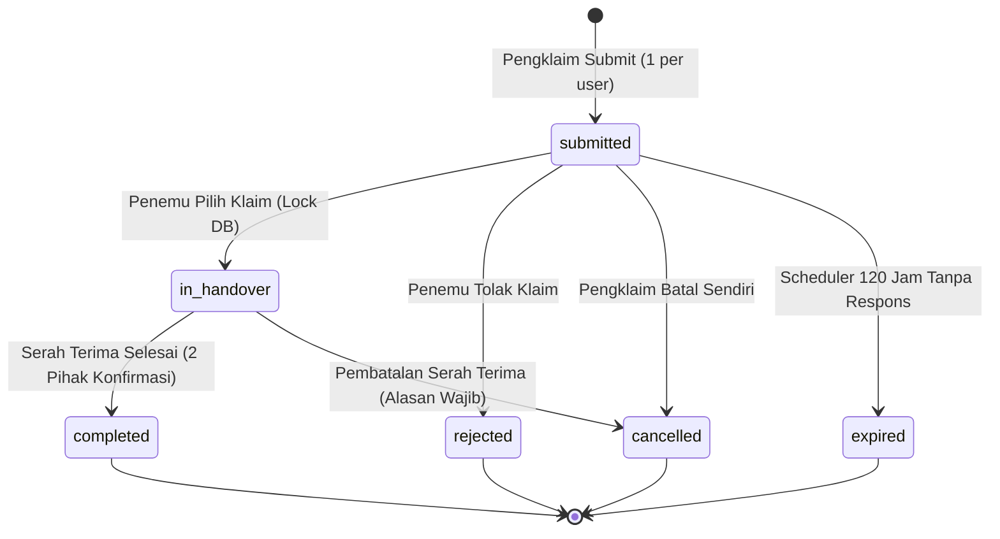

# API Contract & Handover Specification
# UMBFind — Campus Lost & Found Platform

**Versi Dokumen:** 1.0 (Final Front-End Handover)  
**Status:** Disetujui Tim Front-End (*Ready for Back-End Implementation*)  
**Acuan Resmi:** `docs/PRD.md`, `docs/SRS.md`, `docs/SYSTEM_DESIGN.md`, `docs/DATABASE_DESIGN.md`, `docs/DECISIONS_LOG.md` (DEC-001 s.d. DEC-026)  
**Target Arsitektur:** Laravel 11.x RESTful API + Blade Hybrid with Session/Sanctum Authentication

---

## 1. Pendahuluan & Prinsip Desain API

Dokumen ini merupakan **kontrak resmi antarmuka pemrograman aplikasi (API Contract)** yang menjembatani seluruh komponen Front-End (tampilan Blade, formulir interaktif, state Alpine.js, dan modal dialog) yang telah selesai dibangun dengan lapisan Back-End (Controllers, Eloquent Models, Form Requests, dan Database Migrations).

### Prinsip Utama Integrasi:
1. **Stateless API Ready & Session Compatible:** Endpoint dirancang kompatibel untuk pemanggilan AJAX/Fetch modern dari Blade (`fetch` / `axios` dengan `X-CSRF-TOKEN`) maupun integrasi PWA mobile di masa mendatang via `Authorization: Bearer <token>`.
2. **Integritas Aturan Bisnis (DEC-001 s.d. DEC-026):** Validasi hak akses, pembatasan 1 klaim aktif, verifikasi email `@mercubuana.ac.id`, pencegahan klaim berulang, dan mekanisme pembatalan serah terima **wajib ditegakkan mutlak di server**.
3. **Format Respons Konsisten:** Semua respons HTTP wajib mematuhi *Response Envelope* standar yang telah ditetapkan di dokumen ini.

---

## 2. Standar Konvensi & HTTP Envelope

### 2.1 Request Headers
Setiap request ke endpoint wajib menyertakan header berikut:
```http
Content-Type: application/json
Accept: application/json
X-Requested-With: XMLHttpRequest
X-CSRF-TOKEN: <csrf_token_dari_meta_tag>
```
*Catatan untuk unggah berkas (Multipart):* Omit header `Content-Type` agar browser/client menyetel `multipart/form-data; boundary=...` secara otomatis.

---

### 2.2 Standard Success Envelope
```json
{
  "success": true,
  "message": "Laporan barang berhasil dibuat.",
  "data": {
    "id": 142,
    "title": "KTM Mahasiswa Fasilkom",
    "status": "open",
    "created_at": "2026-11-06T14:00:00Z"
  },
  "meta": {
    "timestamp": "2026-11-06T14:00:00Z",
    "version": "1.0"
  }
}
```

---

### 2.3 Standard Paginated List Envelope
Digunakan untuk katalog barang, riwayat, dan notifikasi:
```json
{
  "success": true,
  "data": [
    { "id": 1, "title": "Dompet Kulit Cokelat", "status": "open" },
    { "id": 2, "title": "Kunci Motor Honda", "status": "in_handover" }
  ],
  "pagination": {
    "current_page": 1,
    "per_page": 12,
    "total": 48,
    "last_page": 4,
    "has_next_page": true,
    "has_prev_page": false
  }
}
```

---

### 2.4 Standard Error Envelope (RFC 7807 Compliant)
Mengikuti standar error bawaan Laravel Form Request (`HTTP 422 Unprocessable Entity`):
```json
{
  "success": false,
  "message": "Validasi formulir gagal. Silakan periksa kembali data Anda.",
  "errors": {
    "email": [
      "Alamat email harus menggunakan domain resmi @mercubuana.ac.id atau @student.mercubuana.ac.id."
    ],
    "image": [
      "Ukuran foto maksimal adalah 2MB."
    ]
  },
  "code": 422
}
```

#### Daftar Kode Status HTTP yang Digunakan:
* `200 OK`: Permintaan berhasil dan menghasilkan data.
* `201 Created`: Entitas baru (laporan, klaim, pesan) berhasil dibuat.
* `400 Bad Request`: Permintaan tidak valid secara format atau logika bisnis awal.
* `401 Unauthorized`: Pengguna belum login atau token sesi kedaluwarsa.
* `403 Forbidden`: Pengguna login tetapi tidak memiliki hak akses (misal: non-admin membuka panel admin, atau akun berstatus `suspended`).
* `404 Not Found`: Data (laporan, klaim, akun) tidak ditemukan.
* `409 Conflict`: Terjadi kondisi persaingan (*race condition*), misalnya klaim sudah diambil orang lain menjadi `in_handover`.
* `422 Unprocessable Entity`: Validasi input formulir gagal.
* `500 Internal Server Error`: Kesalahan tidak terduga pada server.

---

## 3. Definisi Tipe Data & Status Enum

| Nama Enum | Nilai-Nilai Sah (*Allowed Values*) | Penjelasan Bisnis |
| :--- | :--- | :--- |
| `UserRole` | `'user'`, `'admin'` | Peran akses sistem. |
| `UserStatus` | `'active'`, `'suspended'` | Status akun civitas (penonaktifan berdampak pada DEC-026). |
| `ReportType` | `'lost'`, `'found'` | `lost` = Kehilangan, `found` = Menemukan barang. |
| `ReportStatus` | `'open'`, `'in_handover'`, `'resolved'`, `'cancelled'`, `'hidden'` | Lifecycle laporan (lihat seksi 5). |
| `ClaimStatus` | `'submitted'`, `'in_handover'`, `'completed'`, `'rejected'`, `'cancelled'`, `'expired'` | Lifecycle klaim (lihat seksi 6). |
| `CampusLocation` | `'meruya'`, `'menteng'`, `'pejaten'`, `'warung_buncit'` | Lokasi kampus Universitas Mercu Buana. |
| `AbuseTargetType`| `'report'`, `'chat_message'` | Target pelaporan pelanggaran konten/pengguna. |
| `ModerationAction`| `'hide_report'`, `'unhide_report'`, `'suspend_user'`, `'reactivate_user'`, `'cancel_claim'` | Log aksi moderasi admin. |

---

## 4. Modul Autentikasi & Akun Civitas (`/api/v1/auth`)

### 4.1 Login Civitas
* **Endpoint:** `POST /api/v1/auth/login`
* **Hak Akses:** Publik (Guest)
* **Request Body:**
  ```json
  {
    "email": "mahasiswa@student.mercubuana.ac.id",
    "password": "Password123!",
    "remember": true
  }
  ```
* **Validasi Server:**
  * `email`: `required|string|email`
  * `password`: `required|string`
* **Response (200 OK):**
  ```json
  {
    "success": true,
    "message": "Login berhasil.",
    "data": {
      "user": {
        "id": 12,
        "name": "Ahmad Fauzi",
        "email": "mahasiswa@student.mercubuana.ac.id",
        "role": "user",
        "status": "active",
        "email_verified_at": "2026-09-01T08:00:00Z"
      },
      "token": "1|sanctum_token_string_here"
    }
  }
  ```

---

### 4.2 Registrasi Akun Baru (Domain Kampus Wajib)
* **Endpoint:** `POST /api/v1/auth/register`
* **Hak Akses:** Publik (Guest)
* **Request Body:**
  ```json
  {
    "name": "Siti Nurhaliza",
    "email": "siti.nurhaliza@student.mercubuana.ac.id",
    "password": "PasswordRahasia123!",
    "password_confirmation": "PasswordRahasia123!"
  }
  ```
* **Validasi Server:**
  * `email`: `required|string|email|unique:users,email|ends_with:@mercubuana.ac.id,@student.mercubuana.ac.id` (Enforcement DEC-016).
  * `password`: `required|string|min:8|confirmed`

---

### 4.3 Profil Pengguna Sedang Login
* **Endpoint:** `GET /api/v1/auth/me`
* **Hak Akses:** Autentikasi Aktif (`auth:sanctum` atau Session Cookie)
* **Response (200 OK):** Mengembalikan data lengkap pengguna termasuk rekap jumlah laporan aktif dan notifikasi belum dibaca.

---

## 5. Modul Laporan Barang Hilang & Ditemukan (`/api/v1/reports`)

### 5.1 Publik: Daftar & Pencarian Laporan
* **Endpoint:** `GET /api/v1/reports`
* **Hak Akses:** Publik (Pengunjung tanpa login / Civitas login)
* **Query Parameters:**
  * `type`: (Opsional) `'lost'` atau `'found'`.
  * `category_id`: (Opsional) Integer ID dari `item_categories`.
  * `campus`: (Opsional) `'meruya'`, `'menteng'`, `'pejaten'`, `'warung_buncit'`.
  * `month`: (Opsional) Integer 1 s.d. 12 (Filter kalender bulanan sesuai `search.blade.php`).
  * `year`: (Opsional) Integer (default: tahun berjalan).
  * `status`: (Opsional) Default: `'open'` (Kecuali jika user memfilter laporan selesai).
  * `q`: (Opsional) Teks pencarian kata kunci pada judul atau deskripsi.
  * `page`: Integer (default: 1).
  * `per_page`: Integer (default: 12).
* **Response (200 OK):** List laporan publik terpaginasi (foto, judul, kategori, lokasi gedung, tanggal kejadian, status badge).

---

### 5.2 Publik: Detail Laporan Barang
* **Endpoint:** `GET /api/v1/reports/{id}`
* **Hak Akses:** Publik
* **Aturan Keamanan Data (Blind Information):**
  * Jika `type = 'found'`, informasi sensitif ciri khusus tidak ditampilkan ke publik.
  * Hanya penemu atau pengklaim yang sah yang dapat melihat pertanyaan rahasia (*proof question*).

---

### 5.3 Civitas: Buat Laporan Barang Hilang / Temuan
* **Endpoint:** `POST /api/v1/reports`
* **Hak Akses:** Login + Email Kampus Terverifikasi + Akun Aktif (`auth`, `verified`, `active`)
* **Content-Type:** `multipart/form-data`
* **Request Fields:**
  | Field | Tipe | Wajib? | Keterangan / Validasi |
  | :--- | :--- | :--- | :--- |
  | `type` | String | Ya | Enum: `'lost'` atau `'found'`. |
  | `title` | String | Ya | Min: 5, Max: 100 karakter. |
  | `category_id` | Integer | Ya | `exists:item_categories,id`. |
  | `campus` | String | Ya | Enum lokasi kampus. |
  | `location` | String | Ya | Lokasi spesifik (misal: "Gedung Tower Lt. 1"). Max: 150 karakter. |
  | `incident_date` | Date | Ya | Format: `YYYY-MM-DD`, `before_or_equal:today`. |
  | `description` | String | Ya | Min: 20, Max: 1000 karakter. |
  | `image` | File | Tidak | Opsional, max 2048 KB (2MB), mimes: `jpg,jpeg,png,webp`. |
  | `proof_question` | String | Kondisional | **Wajib jika `type = 'found'`**. Pertanyaan rahasia untuk memverifikasi pemilik sah. |
  | `storage_location`| String | Kondisional | Jika `found`: `'self'` (Disimpan sendiri) atau `'security_post'` (Dititipkan satpam). |
  | `security_post_id`| Integer | Kondisional | Wajib jika `storage_location = 'security_post'`. |

* **Response (201 Created):** Objek laporan yang baru dibuat.

---

### 5.4 Civitas: Pembatalan Laporan Milik Sendiri
* **Endpoint:** `POST /api/v1/reports/{id}/cancel`
* **Hak Akses:** Pemilik Laporan (`reports.user_id == auth()->id()`)
* **Aturan Bisnis:** Laporan **tidak boleh dibatalkan** jika statusnya sedang `in_handover` (harus menyelesaikan alur pembatalan serah terima terlebih dahulu).
* **Response (200 OK):** Status laporan diperbarui menjadi `'cancelled'`.

---

## 6. Modul Klaim & Verifikasi Kepemilikan (`/api/v1/claims`)

Mekanisme klaim mengimplementasikan keputusan arsitektur **DEC-025** dan **DEC-026**:



### 6.1 Ajukan Klaim Terhadap Barang Temuan
* **Endpoint:** `POST /api/v1/reports/{report_id}/claims`
* **Hak Akses:** Login + Email Terverifikasi + Akun Aktif
* **Aturan Integritas Validasi Server:**
  1. Laporan target harus berstatus `'open'` dan bertipe `'found'`.
  2. Pembuat laporan dilarang mengklaim barangnya sendiri (`reports.user_id != auth()->id()`).
  3. **Batasan 1 Klaim Aktif:** Pengguna dilarang mengajukan klaim baru jika masih memiliki klaim berstatus `'submitted'` atau `'in_handover'` di laporan manapun.
  4. **Pencegahan Klaim Ulang:** Pengguna dilarang klaim ulang pada laporan yang sama jika riwayat klaim sebelumnya berstatus `'rejected'` atau `'cancelled'` oleh dirinya sendiri.
* **Request Body (JSON / Multipart):**
  ```json
  {
    "proof_answer": "Di dalam dompet ada kartu flazz BCA saldo 45rb dan foto polaroid kecil.",
    "claim_reason": "Dompet saya terjatuh saat makan siang di Kantin D sekitar jam 12.30.",
    "proof_attachment": "(opsional file foto bukti tambahan)"
  }
  ```
* **Response (201 Created):** Klaim baru berstatus `'submitted'`.

---

### 6.2 Penemu: Setujui Klaim untuk Serah Terima
* **Endpoint:** `POST /api/v1/claims/{id}/accept`
* **Hak Akses:** Penemu Barang Saja (`reports.user_id == auth()->id()`)
* **Aturan Transaksi Database (Pessimistic Lock):**
  * Menggunakan `DB::transaction()` dan `SELECT ... FOR UPDATE`.
  * Memastikan belum ada klaim lain di laporan tersebut yang berstatus `in_handover`.
  * Mengubah status klaim terpilih menjadi `'in_handover'`.
  * Mengubah status laporan menjadi `'in_handover'`.
  * **Klaim mengantre lainnya tetap berstatus `'submitted'`** (DEC-025).

---

### 6.3 Penemu: Tolak Pengajuan Klaim
* **Endpoint:** `POST /api/v1/claims/{id}/reject`
* **Hak Akses:** Penemu Barang Saja
* **Request Body:**
  ```json
  {
    "rejection_reason": "Ciri barang yang disebutkan tidak sesuai dengan fisik asli barang."
  }
  ```
* **Efek Samping:** Status klaim menjadi `'rejected'`. Pengklaim dibebaskan dari pembatasan klaim aktif, tetapi dilarang klaim ulang di laporan ini.

---

### 6.4 Pembatalan Serah Terima yang Terhenti / Mandek
* **Endpoint:** `POST /api/v1/claims/{id}/handover/cancel`
* **Hak Akses:** Penemu atau Pengklaim pada klaim terkait
* **Kondisi:** Status klaim harus sedang `'in_handover'`.
* **Request Body:**
  ```json
  {
    "cancellation_reason": "Pihak pengklaim tidak hadir di Pos Satpam Tower setelah ditunggu 3 hari."
  }
  ```
* **Aturan Mutlak (DEC-025):**
  * Kolom `cancellation_reason` wajib diisi teks (min 10 karakter).
  * Kolom `cancelled_by` diisi `auth()->id()` (mencatat aktor pembatal).
  * Status klaim ini berubah menjadi `'cancelled'` (terminal).
  * **Status laporan kembali menjadi `'open'`** sehingga penemu dapat memilih klaim mengantre lainnya.
  * **Aturan Klaim Ulang:**
    * Jika dibatalkan oleh *Pengklaim* (`cancelled_by = claimant_id`), ia dilarang klaim ulang.
    * Jika dibatalkan oleh *Penemu* (`cancelled_by = finder_id`), pengklaim diperbolehkan klaim ulang selama laporan masih `open`.

---

### 6.5 Konfirmasi Serah Terima Selesai (Dua Pihak)
* **Endpoint:** `POST /api/v1/claims/{id}/handover/confirm`
* **Hak Akses:** Penemu atau Pengklaim
* **Kondisi:** Status klaim harus sedang `'in_handover'`.
* **Mekanisme Atomik Server:**
  * Menyimpan baris pada tabel `handover_confirmations`.
  * Dijamin oleh database constraint `UNIQUE KEY (claim_id, user_id)` (mencegah klik ganda).
  * Jika jumlah konfirmasi pada klaim tersebut mencapai **2 pihak sah**:
    1. Status klaim diubah menjadi `'completed'`.
    2. Status laporan diubah menjadi `'resolved'`.
    3. Seluruh klaim mengantre lainnya (`status = 'submitted'`) diubah otomatis oleh sistem menjadi `'cancelled'` dengan `cancelled_by = NULL` dan tanpa sanksi bagi pengklaim antrean.
    4. Chat dikunci permanen menjadi *read-only*.

---

## 7. Modul Pesan & Komunikasi Privat (`/api/v1/chats`)

### 7.1 Daftar Percakapan Pengguna
* **Endpoint:** `GET /api/v1/chats`
* **Response (200 OK):** Daftar percakapan aktif & historis, nama lawan bicara, judul barang, pesan terakhir, waktu, dan jumlah pesan belum dibaca (`unread_count`).

---

### 7.2 Ambil Riwayat Pesan dalam Klaim
* **Endpoint:** `GET /api/v1/claims/{claim_id}/messages`
* **Hak Akses:** Hanya penemu atau pengklaim terkait.
* **Response (200 OK):**
  ```json
  {
    "success": true,
    "data": {
      "claim_id": 45,
      "item_title": "Tas Laptop Lenovo ThinkPad",
      "status": "in_handover",
      "is_readonly": false,
      "messages": [
        {
          "id": 101,
          "sender_id": 8,
          "sender_name": "Budi Santoso",
          "message": "Barang sudah diamankan di Ruang Lab Komputer Lt. 3. Silakan mampir.",
          "created_at": "2026-11-05T09:15:00Z",
          "is_me": false
        }
      ]
    }
  }
  ```

---

### 7.3 Kirim Pesan Baru
* **Endpoint:** `POST /api/v1/claims/{claim_id}/messages`
* **Hak Akses:** Penemu atau Pengklaim
* **Aturan Bisnis:** Pesan **hanya boleh dikirim** jika status klaim adalah `'submitted'` atau `'in_handover'`. Jika berstatus terminal (`completed`, `rejected`, `cancelled`, `expired`), request ditolak dengan `HTTP 403 Forbidden` ("Percakapan telah ditutup").
* **Request Body:**
  ```json
  {
    "message": "Baik kak, saya sedang menuju ke sana sekarang."
  }
  ```

---

## 8. Modul Notifikasi In-App (`/api/v1/notifications`)

* **`GET /api/v1/notifications`**: Mengambil daftar notifikasi terpaginasi beserta total notifikasi unread.
* **`PATCH /api/v1/notifications/{id}/read`**: Menandai satu notifikasi sebagai telah dibaca.
* **`POST /api/v1/notifications/read-all`**: Menandai seluruh notifikasi pengguna sebagai telah dibaca (mereset badge counter sidebar & mobile bar ke 0).

---

## 9. Modul Panel Administrator & Moderasi (`/api/v1/admin/*`)

Dilindungi oleh middleware `auth` + `role:admin`.

### 9.1 Ringkasan KPI & Statistik
* **Endpoint:** `GET /api/v1/admin/overview`
* **Response (200 OK):**
  * `total_reports`: Total seluruh laporan.
  * `open_reports`: Laporan aktif.
  * `resolved_reports`: Laporan selesai.
  * `total_users`: Total civitas terdaftar.
  * `pending_moderations`: Antrean laporan/konten yang dilaporkan civitas.

---

### 9.2 Moderasi Laporan (Sembunyikan / Buka Kembali)
* **Endpoint:** `PATCH /api/v1/admin/reports/{id}/status`
* **Request Body:**
  ```json
  {
    "status": "hidden",
    "reason": "Mengandung konten sensitif / data pribadi terlarang."
  }
  ```
* **Pencatatan Audit:** Wajib otomatis membuat record baru di tabel `moderation_actions`.

---

### 9.3 Moderasi Akun Pengguna (Suspend / Reactivate) — Sesuai DEC-026
* **Endpoint:** `PATCH /api/v1/admin/users/{id}/status`
* **Request Body:**
  ```json
  {
    "status": "suspended",
    "reason": "Indikasi tindakan penipuan klaim berulang."
  }
  ```
* **Dampak Bisnis Server (DEC-026):**
  * **Jika Pengguna adalah Pengklaim:** Seluruh klaim aktifnya dibatalkan (`cancelled_by = admin_id`). Jika klaim sedang `in_handover`, laporan terkait dikembalikan ke status `open`.
  * **Jika Pengguna adalah Penemu:** Seluruh laporannya diubah ke status `hidden`. Klaim aktif terkait dibatalkan tanpa sanksi bagi pengklaim.
  * **Reaktivasi Akun:** Mengembalikan status pengguna menjadi `'active'` **tidak menghidupkan kembali** transaksi terminal masa lalu (*immutable*).

---

### 9.4 Tata Kelola Kategori Barang
* **`GET /api/v1/admin/categories`**: Daftar kategori aktif dan nonaktif.
* **`POST /api/v1/admin/categories`**: Tambah kategori baru (`name`, `description`).
* **`PUT /api/v1/admin/categories/{id}`**: Perbarui nama/deskripsi/status aktif kategori.
* **`DELETE /api/v1/admin/categories/{id}`**: Hapus kategori (hanya jika belum digunakan di tabel `reports`).

---

## 10. Matriks Pemetaan Front-End Views $\longleftrightarrow$ Back-End Controllers

Tabel ini menjadi panduan langsung bagi Back-End Developer untuk menghubungkan view Blade yang ada dengan Controller yang akan dibuat:

| File Blade Front-End | Controller Rekomendasi | Metode & Endpoint Terkait |
| :--- | :--- | :--- |
| `resources/views/welcome.blade.php` | `ReportController@index` | `GET /` & `GET /api/v1/reports?limit=8` |
| `resources/views/search.blade.php` | `ReportController@search` | `GET /search` & `GET /api/v1/reports` |
| `resources/views/report-lost.blade.php` | `ReportController@createLost` / `store` | `POST /api/v1/reports` (`type=lost`) |
| `resources/views/report-found.blade.php` | `ReportController@createFound` / `store` | `POST /api/v1/reports` (`type=found`) |
| `resources/views/report-detail.blade.php` | `ReportController@show`, `ClaimController@store` | `GET /report/{id}`, `POST /api/v1/reports/{id}/claims` |
| `resources/views/messages.blade.php` | `ChatController@index`, `HandoverController` | `GET /messages`, `POST /api/v1/claims/{id}/handover/*` |
| `resources/views/my-reports.blade.php` | `UserActivityController@index` | `GET /my-reports`, `GET /api/v1/user/activities` |
| `resources/views/notifications.blade.php` | `NotificationController@index` | `GET /notifications`, `PATCH /api/v1/notifications/{id}/read` |
| `resources/views/profile.blade.php` | `ProfileController@show` / `update` | `GET /profile`, `PUT /api/v1/user/profile` |
| `resources/views/settings.blade.php` | `SettingsController@update` | `GET /settings`, `PUT /api/v1/user/settings` |
| `resources/views/admin/dashboard.blade.php`| `Admin\DashboardController`, `Admin\ModerationController` | `GET /admin`, `PATCH /api/v1/admin/*` |

---

## 11. Daftar Periksa Handover (*Handover Checklist*)

Sebelum tim Back-End memulai penulisan controller dan migrasi, seluruh item berikut telah terverifikasi:
- [x] Seluruh view antarmuka (11 file blade + 2 layout) selesai dan responsif.
- [x] Input name atribut pada form blade telah diselaraskan dengan nama kolom di API contract.
- [x] Modal error handling dan feedback toast telah disediakan di antarmuka.
- [x] Validasi domain kampus `@mercubuana.ac.id` telah tertuang pada formulir dan kontrak API.
- [x] Mekanisme atomik serah terima dua pihak dan pembatalan DEC-025/DEC-026 terdefinisi tanpa celah logika.
- [x] Spesifikasi siap dieksekusi oleh tim Back-End.

