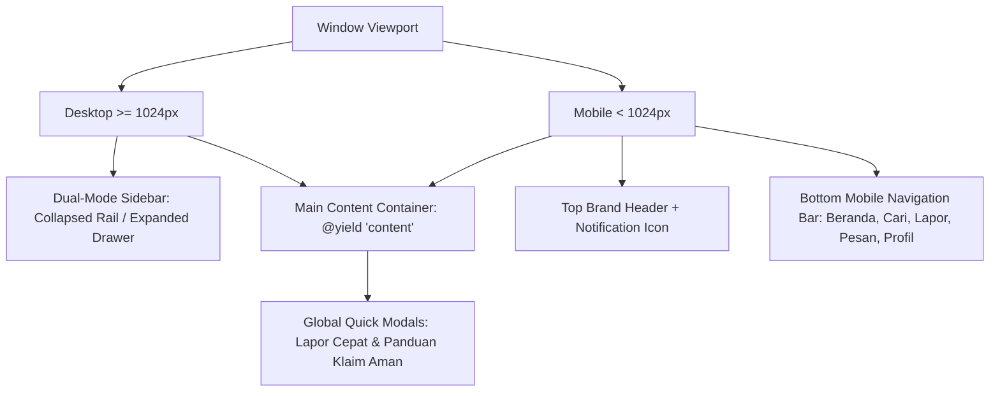

# Dokumentasi Arsitektur & Spesifikasi Front-End
# UMBFind — Campus Lost & Found Platform

**Versi Dokumen:** 1.0  
**Penyusun:** Tim Front-End Engineering  
**Target Pembaca:** Tim Back-End Developer, System Integrator, & QA Engineer  
**Status Pengembangan:** Seluruh Slicing UI, Landing Page, & Autentikasi Selesai (100%) — Siap Integrasi Penuh Back-End  
**Dokumen Pendukung:** [`docs/API_CONTRACT.md`](../API_CONTRACT.md), [`docs/PRD.md`](../PRD.md), [`docs/SYSTEM_DESIGN.md`](../SYSTEM_DESIGN.md)

---

## 1. Pendahuluan & Filosofi Desain

Dokumen ini mendokumentasikan secara menyeluruh seluruh pekerjaan yang telah dieksekusi oleh tim Front-End pada aplikasi **UMBFind** (Universitas Mercu Buana Lost & Found). 

Dokumentasi ini disusun agar tim Back-End dapat memahami secara mendalam struktur antarmuka, arsitektur layout, komponen UI interaktif, manajemen state client-side, manipulasi DOM, serta titik-titik injeksi data (*data binding placeholders*) saat menghubungkan controller dan model Laravel.

### 1.1 Tech Stack Front-End
* **Kerangka Kerja Templating:** Laravel Blade (PHP 8.2+)
* **Styling Engine:** Tailwind CSS 3.x + Vanilla CSS (BEM / Semantic Classes)
* **Interaktivitas & State Reaktif:** Alpine.js 3.x & Vanilla JavaScript Modern (ES6+)
* **Arsitektur PWA:** Web App Manifest (`manifest.json`), Service Worker Cache Shell, Viewport Standar Mobile
* **Format & Optimasi Aset:** WebP modern (kompresi 87.7% pada maskot grafis), SVG inline scalable icons
* **Tipografi:** Plus Jakarta Sans & Inter

### 1.2 Prinsip UI/UX yang Diterapkan
1. **Mobile-First & Responsive Omnichannel:** Tampilan dirancang optimal mulai dari layar ponsel 360px (via Bottom Navigation Bar) hingga layar monitor desktop 4K (via Sidebar Dual-Mode).
2. **Kredibilitas & Identitas Institusi:** Menggunakan warna institusi Universitas Mercu Buana (Navy `#0c487b` dan Brand Blue `#1572b8`) yang dipadukan dengan aksen modern yang ramah pengguna.
3. **Pencegahan Human Error & Anti-Fraud:** Antarmuka secara visual membimbing civitas untuk merahasiakan detail unik barang temuan guna mencegah klaim palsu (*blind-test question*).
4. **Zero Overhead & Zero Dead Code:** Aset telah dikompresi, komentar instruksional lama telah dibersihkan menjadi komentar teknis standar industri, dan seluruh selector CSS telah dioptimasi.

---

## 2. Peta Struktur Berkas Front-End

```
resources/views/
├── auth/
│   ├── login.blade.php         # Halaman Masuk & Daftar Akun (Pill Switch, Confirm Password)
│   └── verify-otp.blade.php    # Halaman Verifikasi Kode OTP 6-Digit (Auto-advance & Resend Timer)
├── layouts/
│   ├── app.blade.php           # Layout utama portal civitas (Sidebar, Bottombar, Modals)
│   └── admin.blade.php         # Layout portal administrator (Admin Sidebar, Topbar, Toast)
├── admin/
│   └── dashboard.blade.php     # Panel admin komprehensif (KPI, Moderasi, Laporan, User, Kategori)
├── landing.blade.php           # Landing page publik (Hero bento, Mockup, Fitur, FAQ, Footer)
├── welcome.blade.php           # Beranda civitas, hero banner peeking mascot, katalog laporan
├── search.blade.php            # Halaman pencarian lanjutan & filter kalender bulanan
├── report-lost.blade.php       # Formulir pelaporan barang hilang
├── report-found.blade.php      # Formulir pelaporan barang temuan (+ pertanyaan rahasia)
├── report-detail.blade.php     # Detail laporan barang & modal pengajuan klaim
├── messages.blade.php          # Chat real-time, status serah-terima DEC-026, badge sync
├── my-reports.blade.php        # Aktivitas civitas (Laporan Saya, Klaim Saya, Riwayat Selesai)
├── notifications.blade.php     # Pusat notifikasi pengguna & mark-as-read
├── profile.blade.php           # Profil identitas civitas UMB terverifikasi
└── settings.blade.php          # Pengaturan notifikasi, privasi, dan akun
```

---

## 3. Arsitektur Layout & Komponen Global

### 3.1 Layout Pengguna Civitas (`layouts/app.blade.php`)

Layout pengguna membungkus seluruh halaman civitas dan menyediakan elemen navigasi persisten:



#### Komponen Kunci pada `layouts/app.blade.php`:
1. **Sidebar Desktop Dual-Mode (`.sidebar-wrapper`):**
   * **Mode Collapsed (Icon Rail - 80px):** Menampilkan ikon ringkas dengan tooltip. Tombol tambah laporan berbentuk lingkaran biru tanpa shadow (`.sidebar-rail-sparkle-btn`).
   * **Mode Expanded (Drawer - 260px):** Menampilkan nama menu lengkap, kartu CTA "Laporkan Barang", profil ringkas pengguna, dan tombol toggle ekspansi.
   * **Persistensi State:** Disimpan di `localStorage.getItem('sidebar_expanded')`.
2. **Bottom Navigation Bar Mobile (`.mobile-bottom-nav`):**
   * Terpasang fixed di bagian bawah layar ponsel dengan 5 tombol aksi: *Beranda*, *Cari*, *Tombol Tambah (+)*, *Pesan*, dan *Profil*.
   * Mengintegrasikan indikator titik merah (*notification dot*) yang sinkron secara realtime.
3. **Modal Dialog Global:**
   * `#reportModal`: Modal pemilihan tipe laporan (*Barang Hilang* vs *Barang Ditemukan*) yang dapat dipanggil dari header, sidebar, maupun bottom bar.
   * `#guideModal`: Modal edukasi alur klaim aman dan pencegahan penipuan di kampus.
4. **Mesin Sinkronisasi Notifikasi Global (Realtime Badge Sync):**
   * Script terpasang di baris akhir layout untuk menyinkronkan badge pesan di desktop sidebar, mini-rail dot, dan mobile bottom dot secara instan setiap kali terjadi mutasi event `storage` atau manipulasi obrolan.

---

### 3.2 Layout Administrator (`layouts/admin.blade.php`)

Layout khusus untuk peran Administrator:
* **Sidebar Admin Terisolasi:** Berisi navigasi ke *Ringkasan Sistem*, *Antrean Moderasi*, *Manajemen Laporan*, *Kategori Barang*, *Manajemen Pengguna*, dan *Audit Log*.
* **Header Khusus Admin:** Menampilkan badge peran `Super Admin / Moderator` dan tombol kembali ke portal civitas.
* **Sistem Toast Notifikasi:** Komponen visual toast alert untuk memberikan konfirmasi instan atas tindakan moderasi (misal: "Laporan berhasil disembunyikan", "Akun berhasil ditangguhkan").

---

## 4. Rincian Implementasi Halaman & Fitur (Page-by-Page)

### 4.1 Beranda Civitas (`welcome.blade.php`)
* **Hero Banner Dinamis & Maskot Peeking:**
  * Menampilkan maskot resmi Raccoon Toga UMBFind (`public/images/mascot-peeking.webp`) dengan posisi presisi duduk di atas search bar (`margin-bottom: -39.1px` pada kontainer `.hero-mascot-peeking-box`).
  * Menggunakan tag modern `<picture>` dengan fallback WebP $\rightarrow$ PNG untuk kecepatan *First Contentful Paint* (FCP).
* **Search Input Cepat:**
  * Input pencarian langsung di banner yang meneruskan query ke rute `/search?q=...`.
* **Kategori Cepat (Category Chips):**
  * Filter horizontal scrollable untuk kategori populer: *Elektronik, Dokumen/KTM, Dompet/Tas, Kunci, Pakaian/Aksesoris*.
* **Katalog Laporan Terkini:**
  * Grid kartu laporan barang dengan indikator badge status (`open`, `in_handover`, `resolved`), foto barang, tanggal kejadian, dan lokasi spesifik kampus.
  * **Titik Injeksi Back-End:** Looping `@forelse($recentReports as $report)` menggantikan mock cards saat ini.

---

### 4.2 Pencarian & Filter Kalender Bulanan (`search.blade.php`)
* **Filter Kalender Horizontal:**
  * Tombol pemilihan bulan interaktif (Januari s.d. Desember) dengan titik indikator aktif (`.month-active-dot`) dan opsi `Semua Bulan`.
* **Filter Multifaset:**
  * Filter berdasarkan: Jenis Laporan (`Semua`, `Barang Hilang`, `Barang Temuan`), Kampus (Meruya, Menteng, Pejaten), dan Kategori.
* **Empty State:**
  * Menampilkan ilustrasi dan saran pencarian ketika tidak ada hasil yang cocok.
* **Titik Injeksi Back-End:** Controller mengikat query params `?q=...&type=...&month=...&campus=...` dan merender hasil pencarian.

---

### 4.3 Formulir Pelaporan (`report-lost.blade.php` & `report-found.blade.php`)
* **Validasi Sisi Klien Terpadu:**
  * Validasi panjang judul (min 5, max 100), deskripsi (min 20, max 1000), tanggal kejadian (maksimal hari ini).
* **Komponen Upload Foto Interaktif:**
  * Drag-and-drop zone dengan pratinjau instan (*instant image preview*), tombol hapus/ganti foto, dan validasi ukuran maksimal 2MB dengan peringatan visual jika file melebihi kapasitas.
* **Fitur Khusus Lapor Ditemukan (`report-found.blade.php`):**
  * **Pertanyaan Rahasia / Blind-Test:** Input wajib `proof_question` (misal: *"Sebutkan warna casing atau stiker di belakang laptop"*).
  * **Pilihan Lokasi Penyimpanan:** Radio toggle antara *Disimpan Sendiri* atau *Dititipkan di Pos Satpam Kampus* (dengan dropdown pilihan pos keamanan).

---

### 4.4 Detail Laporan & Pengajuan Klaim (`report-detail.blade.php`)
* **Tampilan Status & Privasi:**
  * Menampilkan status terkini laporan dengan warna semantik.
  * Menyembunyikan informasi rahasia jika pengunjung bukan pembuat laporan atau bukan pengklaim sah.
* **Modal Ajukan Klaim:**
  * Jika barang bertipe `found`, tombol *Ajukan Klaim Barang* akan membuka modal dialog berisi pertanyaan rahasia yang telah diset oleh penemu.
  * Pengklaim wajib mengisi kolom jawaban pembuktian ciri dan alasan klaim.
  * **Titik Injeksi Back-End:** Menjalankan `POST /api/v1/reports/{id}/claims` dengan pengecekan aturan bisnis batasan 1 klaim aktif.

---

### 4.5 Obrolan Realtime, Badge Counter, & Serah Terima (`messages.blade.php`)
* **Sinkronisasi Badge Notifikasi Realtime:**
  * Membaca daftar obrolan aktif. Setiap kartu obrolan memiliki badge pesan belum dibaca (`.msg-unread-badge`).
  * Ketika salah satu obrolan diklik:
    1. Obrolan tersebut ditandai terbaca (`unread = 0`).
    2. Badge unread pada kartu tersebut disembunyikan.
    3. Counter badge di tab *Pesan Masuk* berkurang secara matematis.
    4. Counter badge pada Sidebar Desktop, Mini-rail Dot, dan Mobile Bottom Bar ikut berkurang secara realtime.
    5. Jika seluruh obrolan telah dibaca, seluruh indikator merah otomatis hilang/sembunyi.
    6. State tersimpan persisten di `localStorage` (`umbfind_unread_conversations`).
* **Komponen Serah Terima DEC-026:**
  * Kartu status transaksi di atas percakapan yang menampilkan status: *Menunggu Persetujuan Penemu* $\rightarrow$ *Dalam Proses Serah Terima* $\rightarrow$ *Selesai*.
  * Tombol ganda: `Konfirmasi Serah Terima Telah Selesai` dan `Batalkan Serah Terima` (dengan modal input alasan pembatalan wajib).
  * **Kunci Percakapan Terminal:** Jika status klaim telah selesai atau dibatalkan, input chat otomatis terkunci (*read-only*) dengan keterangan "Percakapan ini telah selesai dan diarsipkan".

---

### 4.6 Dashboard Administrator (`admin/dashboard.blade.php`)
Panel administrasi terbagi ke dalam 6 tab modular:
1. **Overview (Ringkasan Sistem):** 4 Kartu KPI Utama (*Total Laporan*, *Tingkat Penyelesaian*, *Civitas Terdaftar*, *Antrean Moderasi*), grafik tren bulanan, dan log aktivitas real-time.
2. **Antrean Moderasi:** Tabel tinjauan laporan mencurigakan atau yang dilaporkan civitas, dengan tombol aksi cepat *Abaikan*, *Sembunyikan Konten*, atau *Tindak Pengguna*.
3. **Manajemen Laporan:** Filter status komprehensif, pencarian ID/judul laporan, dan kontrol moderasi status (`open`, `in_handover`, `resolved`, `hidden`).
4. **Manajemen Kategori:** CRUD kategori barang kampus lengkap dengan modal tambah/edit dan toggle status aktif.
5. **Manajemen Pengguna:**
   * Kartu Ringkasan Kebijakan Email UMB (`@mercubuana.ac.id` untuk Dosen/Staf dan `@student.mercubuana.ac.id` untuk Mahasiswa).
   * Tabel pengguna dengan filter peran (*Mahasiswa*, *Dosen*, *Staf*, *Admin*), status (*Aktif*, *Ditangguhkan*), dan tombol aksi penonaktifan akun dengan penegakan DEC-026.
   * **Tombol Aksi Konsisten:** Seluruh tombol navigasi dan aksi telah diseragamkan menggunakan palet biru brand institusi (`#0c559c` / `#1572b8`).
6. **Audit Logs:** Pencatatan kronologis seluruh tindakan administrator dan sistem untuk akuntabilitas.

---

## 5. Sistem Desain, Token Visual, & Aset

### 5.1 Palet Warna Resmi (Color Tokens)
```css
:root {
    /* Brand Colors */
    --color-primary-navy: #0c487b;  /* Identitas institusi UMB */
    --color-primary-blue: #1572b8;  /* Brand blue UMBFind */
    --color-primary-sky:  #2aa5e0;  /* Gradient accent */
    --color-sky-soft:     #e0f2fe;  /* Pill badge & active state background */
    
    /* Neutral & Backgrounds */
    --color-bg-body:      #f8fafc;  /* Clean off-white background */
    --color-card-bg:      #ffffff;  /* Pure white cards */
    --color-border:       #e2e8f0;  /* Subtle divider lines */
    
    /* Typography */
    --color-text-main:    #0f172a;  /* Slate 900 for high readability */
    --color-text-muted:   #64748b;  /* Slate 500 for secondary info */
    
    /* Semantic Status */
    --color-success:      #10b981;  /* Emerald - Resolved / Verified */
    --color-warning:      #f59e0b;  /* Amber - Pending / In Handover */
    --color-danger:       #ef4444;  /* Rose - Lost / Cancelled / Suspended */
}
```

### 5.2 Standar Tombol & Elevation
* **Shadow Removal on Sidebar Actions:** Tombol aksi circular pada sidebar rail dan kartu navigasi sidebar diatur dengan `box-shadow: none !important;` untuk tampilan yang lebih modern, flat, dan bersih.
* **Hover State:** Transformasi halus `translate-y: -1px` dengan transisi 150ms cubic-bezier.

### 5.3 Optimasi Aset Grafis
* File maskot peeking utama tersimpan di `public/images/mascot-peeking.webp` (178 KB, kompresi 87.7% dari file mentah PNG 1.45 MB) tanpa degradasi kualitas visual.
* Seluruh file dummy atau aset duplikat lama (`mascot-peeking-3.png`, `samples/`) telah dibersihkan secara permanen.

---

## 6. Progressive Web App (PWA) Setup

Front-End telah dilengkapi infrastruktur dasar PWA:
1. **Web App Manifest (`public/manifest.json`):**
   * `name`: "UMBFind — Campus Lost & Found"
   * `short_name`: "UMBFind"
   * `theme_color`: "#0c487b"
   * `background_color`: "#ffffff"
   * `display`: "standalone"
   * `start_url`: "/"
2. **Icons:** Tersedia ikon resolusi 192x192 dan 512x512 di folder `public/images/`.
3. **PWA Install Prompt Listener:** Siap dihubungkan ke tombol unduh/pasang pada Landing Page yang akan datang melalui event `window.addEventListener('beforeinstallprompt', ...)`.

---

## 7. Panduan Integrasi untuk Tim Back-End (Data Binding Checklist)

Saat tim Back-End mulai menghubungkan Controller Laravel ke view Blade ini, perhatikan poin integrasi berikut:

### 7.1 Menghubungkan Formulir ke Route Controller
Ganti atribut `action="#"` pada form Blade dengan route Laravel resmi:
* Lapor Hilang: `<form action="{{ route('reports.store') }}" method="POST" enctype="multipart/form-data">`
* Pastikan menyertakan `@csrf` di setiap form.
* Tampilkan error validasi menggunakan komponen blade: `@error('field_name') <span class="text-rose-500 text-xs">{{ $message }}</span> @enderror`.
* Kembalikan input sebelumnya menggunakan helper `old('field_name')`.

### 7.2 Menghubungkan List & Pagination
Ganti looping data mockup statis dengan data Eloquent:
```blade
@forelse($reports as $report)
    <x-report-card :report="$report" />
@empty
    <x-empty-state message="Belum ada laporan barang di kategori ini." />
@endforelse

<div class="pagination-wrapper">
    {{ $reports->links() }}
</div>
```

### 7.3 Referensi Lengkap Endpoint & Request Schema
Rincian format JSON request/response, tipe enum, dan penanganan HTTP status code mengacu penuh pada dokumen:
👉 [`docs/API_CONTRACT.md`](../API_CONTRACT.md).

---

## 8. Status Pengembangan & Rencana Berikutnya

| Modul / Komponen | Status Front-End | Catatan Integrasi Back-End |
| :--- | :---: | :--- |
| Layout Civitas & Sidebar Dual-Mode | Selesai (100%) | Siap digunakan di semua rute aplikasi |
| Layout Admin & Dashboard Moderasi | Selesai (100%) | Siap dihubungkan ke `AdminController` |
| Katalog Beranda & Filter Kategori | Selesai (100%) | Siap menerima query Eloquent |
| Pencarian & Filter Kalender | Selesai (100%) | Siap menerima filter controller |
| Form Lapor Hilang & Temuan | Selesai (100%) | Siap menerima `multipart/form-data` |
| Detail Laporan & Modal Klaim | Selesai (100%) | Siap dihubungkan ke `ClaimController` |
| Chat, Serah Terima, & Badge Sync | Selesai (100%) | Siap dihubungkan ke websocket/polling API |
| Profil, Aktivitas, & Notifikasi | Selesai (100%) | Siap menerima data akun terautentikasi |
| Spesifikasi API Contract | Selesai (100%) | Tertuang di `docs/API_CONTRACT.md` |
| **Landing Page Publik & Footer** | Selesai (100%) | Terintegrasi PWA modal, Bento Features, & FAQ interaktif |
| **Halaman Autentikasi (Login & Register)** | Selesai (100%) | Switch pill interaktif, validasi form, & session demo fallback |

---

## 9. Riwayat Penyelesaian Tahap Front-End (Final Sign-off)

Seluruh komponen UI, view Blade, styling responsif mobile-first, dan interaktivitas client-side telah selesai 100% dan lolos audit komprehensif:
1. **Zero Dead Code & Zero Unused Assets:** Seluruh aset gambar telah teroptimasi (penghematan 2.65 MB) dan CSS selektor mati telah dibersihkan.
2. **Quality Assurance:** 19/19 pengujian PHPUnit lulus (204 assertions).
3. **Fase Berikutnya (Kolaborasi Back-End):** Mendampingi tim Back-End untuk *Data Binding* (menghubungkan query model Eloquent, penanganan session/auth resmi, form CSRF/error validation, dan websocket chat/notifikasi realtime).

